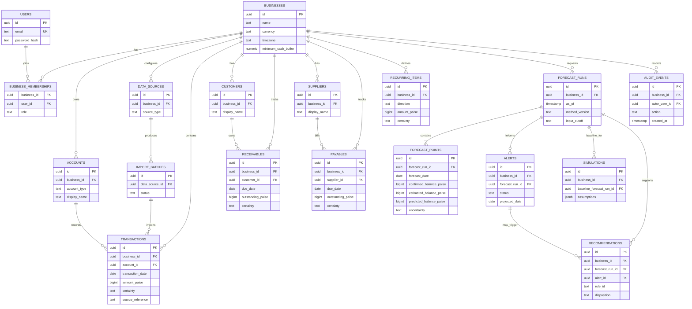

# Cashflow Sentinel — System Architecture

**Program:** Arthaton 2026  
**Architecture style:** React web client, modular-monolith API, PostgreSQL, and a separately deployable Python forecasting service  
**Target:** A small team can build and demonstrate the MVP while retaining clear boundaries for later growth.

## 1. Technology stack

| Layer | MVP choice | Use |
|---|---|---|
| Web client | React + Vite; TypeScript recommended | Dashboard, data review, forecasts, alerts, recommendations, and isolated What-If scenarios. TypeScript adds useful checking across a small team without changing the product architecture. |
| API | Node.js + Express | Public REST API, authentication, business rules, authorization, input validation, persistence, and orchestration of forecasts. Keep it a modular monolith rather than splitting each domain into a service. |
| Database | PostgreSQL | Transactional business data, forecasts, alerts, scenarios, and audit events. Use migrations and foreign-key constraints from the start. |
| Forecasting service | Python + FastAPI | Internal, versioned interface for forecasting and related analytical calculations. It is not called directly by the browser. |
| Financial computation | Python `Decimal` or integer paise for monetary arithmetic; pandas for tabular input and preprocessing; NumPy for numerical operations | Prevent floating-point rounding in money calculations. Keep date, currency, rounding, and sign conventions explicit. |
| Forecast methods | Deterministic cash-flow roll-forward first; scikit-learn or statsmodels only when validated historical data supports a useful baseline | The MVP should not require a trained model. Start with transparent rules and optionally add a simple, back-tested seasonal or payment-delay estimate. |
| Frontend API state | TanStack Query recommended; native fetch wrapped in a small API client | Cache and invalidate server-owned data consistently. Keep temporary form and scenario edits local to the relevant screen. |
| Request validation | Zod on the client for user-friendly form feedback; a Node validation library such as Zod or Joi on the API | The backend is authoritative. Reuse schemas where practical, but never trust browser validation for security or correctness. |

These are recommendations, not a requirement to add every library before the MVP. Avoid an ML platform, message broker, cache, or separate microservices until measured workload or reliability needs justify them.

## 2. High-level architecture

The browser communicates only with the Express API. Express authorizes each operation, reads or writes canonical business data in PostgreSQL, and sends a bounded, normalized input payload to the private FastAPI service when a forecast is needed. The Python service returns computed values and metadata; Express validates and persists the result before returning it to the browser.

```mermaid
flowchart LR
    Owner[Business owner]
    subgraph Client["Frontend — React + Vite"]
        UI[Dashboard, forecast, alerts, simulator]
        APIClient[API client and query cache]
    end
    subgraph App["Application — Node.js + Express"]
        Routes[Versioned REST routes]
        Auth[Authentication and business authorization]
        Modules[Business modules and services]
        Import[Import parsing and validation]
    end
    DB[(PostgreSQL)]
    subgraph Analytics["Private analytics service — Python + FastAPI"]
        Prep[Preprocessing and quality checks]
        Calc[Deterministic cash-flow calculation]
        Forecast[Forecast and risk analysis]
    end
    Sources[CSV, supported statements, manual entries]
    FutureSources[Optional consent-based integrations]

    Owner --> UI
    UI <--> APIClient
    APIClient <-->|HTTPS JSON / upload| Routes
    Routes --> Auth --> Modules
    APIClient -->|CSV / statement upload| Import
    Sources --> Import
    FutureSources -. later, explicit consent .-> Modules
    Import --> Modules
    Modules <-->|scoped reads and writes| DB
    Modules -->|normalized, business-scoped input| Prep
    Prep --> Calc --> Forecast
    Forecast -->|forecast points, assumptions, quality metadata| Modules
    Modules -->|persist forecast, alerts, recommendations| DB
```

### Data certainty contract

All screens and services must preserve the distinction between:

- **Confirmed:** an observed transaction or an item explicitly verified by the owner, such as a reviewed imported payment or confirmed bill. “Confirmed” means confirmed as a record, not that an external payment rail has independently settled it.
- **Estimated:** an expected receipt, expected sales amount, or future obligation entered by the owner or derived from a stated business rule. Store its source, expected date, and any confidence or review state.
- **Predicted:** a model- or rule-derived future value. Store the forecast run, method/version, input cutoff, assumptions, and an uncertainty indicator where available.

Do not silently promote an estimate or prediction to a confirmed transaction. A realized movement should be reconciled to an actual transaction. Forecasts should expose confirmed, estimated, and predicted contributions separately; missing or stale input should lower the displayed confidence, not be hidden.

## 3. Frontend architecture

Organize the React application using the existing `frontend/src` layout:

| Layer | Responsibility |
|---|---|
| `pages/` | Route-level screens: onboarding, dashboard, forecast detail, alerts, receivables, and simulator. Compose features; avoid placing financial calculations in pages. |
| `layouts/` | Shared navigation, business context, and responsive page framing. |
| `components/` | Reusable presentation and domain UI: common controls, dashboard summaries, charts, alert explanations, and simulator controls. Components render certainty labels consistently. |
| `services/` | Typed API client, request/response parsing, and endpoint functions. Centralize authentication headers, correlation IDs, and error normalization here. |
| `hooks/` | Reusable query and UI workflows, such as loading a forecast or acknowledging an alert. |
| `context/` | Small, cross-cutting client context such as the authenticated user and currently selected business. It is not a second cache for server data. |
| `utils/` and `styles/` | Formatting INR and dates, presentation helpers, design tokens, and global styles. Financial arithmetic belongs on the server or analytics service. |
| `assets/` and `public/` | Static images, icons, and public assets only. |

### API communication and state

Use HTTPS JSON REST requests to `/api/v1`; upload supported files to a dedicated import endpoint with explicit size and format limits. The frontend must never connect to PostgreSQL or FastAPI directly. TanStack Query can own fetched server state, including freshness and invalidation after edits. Keep form drafts and unsaved scenario inputs local; persist a scenario only when the owner saves it.

Authentication tokens should be handled using the chosen deployment's secure session design. Prefer short-lived access credentials and a `Secure`, `HttpOnly`, appropriately `SameSite` refresh cookie if refresh cookies are used; protect cookie-authenticated state-changing requests against CSRF. Do not place long-lived credentials in local storage.

### Feature communication

Dashboard cards, forecast charts, and alert lists read from the same API-owned forecast run and show its `as_of` time. An alert links to its forecast run and contributing items. The simulator starts from a selected baseline forecast and sends scenario assumptions to the backend; scenario values do not mutate actual transactions. Recommendations reference the forecast and evidence that produced them. After a transaction, due-date, or opening-balance edit, invalidate affected queries and request a new forecast rather than updating an unrelated component's copy of the balance.

## 4. Backend architecture

Use Express as a **modular monolith**: one deployable application with clear domain modules, shared transaction boundaries, and a single PostgreSQL database. The existing `backend/src` folders map as follows:

- **Routes:** Declare versioned paths, authentication requirements, and request/response contracts. Keep route handlers thin.
- **Middleware:** Parse bounded request bodies, authenticate users, attach request/correlation IDs, enforce authorization and rate limits, validate input, and normalize errors.
- **Controllers:** Translate HTTP requests into service calls and map service results to HTTP responses. They do not contain forecasting or persistence logic.
- **Services:** Implement workflows and business rules, coordinate PostgreSQL transactions, and call the Python service through a private client with timeouts.
- **Models/data access:** Encapsulate parameterized queries and repository operations. Every tenant-scoped read and write requires a business scope.
- **Validators:** Validate types, ranges, dates, currency, and ownership-sensitive inputs at the API boundary.
- **Config and utilities:** Load validated environment configuration at startup; provide shared date, money, logging, and error helpers.
- **Tests:** Exercise domain rules, authorization boundaries, API contracts, and forecast integration behavior.

### Domain module responsibilities

| Module | Responsibility |
|---|---|
| **Authentication** | Registration, login, password verification, token/session lifecycle, and identity. |
| **Businesses** | Business profile, membership, selected-business access, currency/time-zone settings, and operating cash buffer. |
| **Transactions** | CSV/manual ingestion, deduplication assistance, transaction review, categorization, source provenance, and actual transaction history. |
| **Cashflow** | Assemble a dated cash-movement view from opening balances, confirmed transactions, estimates, and obligations; request and persist forecast runs. |
| **Receivables** | Customer invoices/dues, expected dates, outstanding amounts, payment allocations, overdue status, and owner-reviewed delay indicators. |
| **Risk detection** | Apply transparent buffer-breach and overdue rules to forecast results; create or update explainable alerts. It is operational risk detection, not credit risk scoring. |
| **Simulations** | Validate isolated scenario assumptions and compare them with a baseline forecast without altering the ledger. |
| **Recommendations** | Produce ranked rule-based options with evidence, timing, estimated impact, and uncertainty. Keep numerical effects traceable to forecast data. |

Shared services may handle audit events and forecast orchestration. Avoid a separate service per module; extract a module only when there is a concrete independent scaling, ownership, or reliability need.

## 5. AI/ML architecture

### Forecast request and response

1. Express authenticates and authorizes the user and business.
2. The cashflow service loads a bounded, business-scoped time series and expected cash movements from PostgreSQL.
3. Express constructs a normalized request containing INR amounts in integer paise or exact decimal strings, dates, provenance/certainty, relevant assumptions, and a non-identifying business key. Do not send credentials, unrelated personal data, or raw source documents.
4. FastAPI validates the request, checks data quality and history coverage, and returns a versioned forecast response. It has no direct public browser access and, for the MVP, no direct database access.
5. Express validates response shape, persists the forecast run and points, evaluates alerts/recommendations, and returns the persisted result.

Run the forecast on demand for the MVP. Set a strict internal timeout and return a clear retryable error if analytics is unavailable; do not silently return a stale forecast as if it were current. A previously saved run can be shown only when explicitly labeled with its calculation time and input freshness.

### Analytical workflow

1. **Preprocessing:** Normalize dates, signs, currencies, duplicate candidates, and missing values. Preserve source identifiers and certainty labels. Reject or flag malformed rows rather than guessing.
2. **Deterministic financial calculations:** Roll opening cash forward across dated confirmed movements and expected receipts/payables. Use exact money arithmetic and explicit rounding rules. This is the source of truth for balances and scenario deltas.
3. **Forecasting:** Establish a transparent baseline from known future movements. Optionally estimate recurring sales or receipt timing only when history is sufficient and a back-test shows value. Record forecast horizon, method/version, input cutoff, assumptions, and uncertainty. Do not imply that historic seasonality guarantees future sales.
4. **Risk analysis:** Compare projected cash with the configured operating buffer; identify earliest likely breach dates and largest contributing movements. Keep breach rules interpretable and distinguish known outflows from uncertain inflows.
5. **Recommendations:** Apply bounded, evidence-linked rules to suggest review actions, such as confirming a large expected receipt before a discretionary purchase. Include the reason and estimated effect; never make or initiate a payment, collection, borrowing, or credit decision.

### Deterministic calculations, ML, and language models

- **Deterministic logic** owns money arithmetic, balances, due-date comparisons, scenario deltas, buffer thresholds, and displayed numerical impacts.
- **ML predictions** are optional estimates, not ledger facts. Keep model version and uncertainty metadata; measure error against actuals by horizon and data quality before relying on them.
- **LLM-generated explanations** are not required for the MVP. If introduced later, provide only a constrained set of already-calculated facts and approved recommendation templates; validate the output, avoid exposing unnecessary financial data to an external provider, and never let generated text change numeric results or execute actions. Rule-based explanations are preferable for the hackathon.

## 6. Database architecture

PostgreSQL is the canonical store for business data. Store money as integer paise or `NUMERIC` with a documented scale; never use floating-point columns for monetary amounts. Store dates/timestamps with explicit business time-zone semantics. Use migrations, foreign keys, uniqueness constraints for import deduplication where feasible, and indexes on `business_id` plus common date/status filters.

### Major entities

| Entity | Purpose |
|---|---|
| `users` | Login identity and password hash; no business financial data. |
| `businesses` | Tenant root, INR currency, time zone, and operating buffer/settings. |
| `business_memberships` | User-to-business membership and role. |
| `accounts` | Business current account or cash-on-hand source and opening/reconciled balance metadata. |
| `data_sources` / `import_batches` | Import channel and processing provenance; retain enough metadata to trace and review imported rows. Raw uploaded files should not be retained by default. |
| `transactions` | Observed business inflows and outflows with transaction date, amount, category, source, and review state. |
| `customers` / `receivables` | Customer identity and open invoice/dues, due date, outstanding amount, and expected collection date. |
| `suppliers` / `payables` | Supplier identity and expected obligations, due date, and payment status. |
| `recurring_items` | Owner-confirmed rules for repeating commitments or expected inflows; generated occurrences remain estimates until verified. |
| `forecast_runs` / `forecast_points` | Immutable calculation metadata and dated balance components for a forecast horizon. |
| `alerts` | Buffer-breach or overdue alerts tied to a forecast run and their contributing evidence. |
| `simulations` | Saved hypothetical assumptions and comparison metadata; never actual ledger entries. |
| `recommendations` | Rule, evidence references, expected effect, timing, and user disposition for a suggestion. |
| `audit_events` | Security-relevant changes and access events with actor, business, action, timestamp, and correlation ID; exclude secrets and unnecessary transaction details. |

### Entity relationships

The diagram is conceptual; implementation may add join tables for payment allocation and evidence references. Prefer composite foreign keys such as `(business_id, account_id)` and matching unique constraints so a row cannot reference another business's account. Every tenant-owned table carries `business_id`, including forecast-derived records.

### Business-level data isolation

Derive accessible business IDs from the authenticated user's membership on every request. Never accept a client-supplied `business_id` as proof of access. Apply tenant scope in repository methods and include the scope in writes, updates, deletes, joins, and background/internal analytics requests. Test cross-business access explicitly. PostgreSQL row-level security can provide defense-in-depth if the team can reliably set and reset transaction-scoped tenant context; it does not replace API authorization or scoped query design.

## 7. Data flow

### User registration

1. React submits validated registration fields over HTTPS.
2. Express validates and normalizes identity fields, applies registration rate limits, and hashes the password before storage.
3. In one database transaction, create the user and initial business plus owner membership, or create only the user if onboarding defers business setup.
4. Return a short-lived authenticated session or token response without returning the password hash. Audit the security event without logging credentials.

### Transaction import

1. React uploads a supported CSV or statement to Express, with size and type limits.
2. Express authenticates, checks business membership, parses the file as untrusted input, validates headers/date/amount/currency, and reports row-level errors.
3. Present a preview for mapping and owner review. Detect likely duplicates using source reference where available and a cautious date/amount/account heuristic; do not silently discard ambiguous rows.
4. Persist reviewed transactions and provenance in a database transaction. Avoid retaining the raw file by default; if retention is later required, define access, encryption, and deletion policy.
5. Invalidate affected forecast data and record an audit event.

### Cash-flow forecasting

1. The authorized user requests a forecast horizon.
2. Express loads the latest scoped balances, confirmed transactions, open receivables/payables, recurring items, and user assumptions.
3. Express sends normalized financial inputs to FastAPI. Python checks completeness, applies deterministic roll-forward, and returns dated values, predicted components where supported, uncertainty, warnings, and method/version metadata.
4. Express validates and persists an immutable forecast run and points. It returns the run ID, `as_of` time, certainty breakdown, data freshness, and horizon.
5. React renders the chart and upcoming movement list with labels for confirmed, estimated, and predicted amounts.

### Cash-crunch detection

1. The risk-detection module evaluates persisted forecast points against the business's configured minimum cash buffer.
2. It creates or updates an alert for a projected breach, retaining the forecast run, projected date, threshold, and top contributing movements.
3. The user sees the alert with its source items and uncertainty. Correcting a due date or receipt triggers recalculation; the old forecast and alert remain auditable and are marked superseded/resolved as appropriate.

### What-If simulation

1. React submits bounded scenario changes against a selected baseline forecast.
2. Express verifies access to that forecast and validates that all changes apply to the same business and supported movement types.
3. The cashflow/analytics workflow calculates a separate scenario result. The actual transaction, receivable, payable, and baseline forecast remain unchanged.
4. Persist the scenario only when requested; return baseline-versus-scenario dates, balances, and buffer breaches, labeled hypothetical.

### AI recommendations

1. The recommendation module receives a forecast and risk evidence, not an unrestricted prompt containing the full business history.
2. Deterministic rules rank allowed review actions and calculate impacts from the same forecast inputs.
3. Store the rule/evidence references, expected impact, uncertainty, and generation version; return recommendations for owner review.
4. The owner may dismiss or mark a suggestion useful. No recommendation executes a payment, sends a collection message, or initiates borrowing.

## 8. API communication

### React to Express

Use versioned REST endpoints over HTTPS with JSON request/response bodies, consistent pagination for lists, and explicit currency/date formats. Example endpoint responsibilities:

| Endpoint | Responsibility |
|---|---|
| `POST /api/v1/auth/register` | Register user and initial business/workspace. |
| `POST /api/v1/auth/login` | Authenticate and establish a session. |
| `GET /api/v1/businesses/:businessId` | Return an authorized business profile and settings. |
| `POST /api/v1/businesses/:businessId/imports` | Upload and preview/ingest a supported transaction file. |
| `GET /api/v1/businesses/:businessId/transactions` | List scoped transactions with date and review filters. |
| `POST /api/v1/businesses/:businessId/transactions` | Create or correct a manual transaction. |
| `GET /api/v1/businesses/:businessId/receivables` | List open and overdue customer dues. |
| `POST /api/v1/businesses/:businessId/forecasts` | Request a forecast run for a supported horizon. |
| `GET /api/v1/businesses/:businessId/forecasts/:forecastId` | Retrieve a saved forecast and its certainty breakdown. |
| `GET /api/v1/businesses/:businessId/alerts` | List open and historical cash-flow alerts. |
| `POST /api/v1/businesses/:businessId/simulations` | Calculate or save an isolated What-If scenario. |
| `GET /api/v1/businesses/:businessId/recommendations` | Return evidence-linked recommendations. |

Treat endpoint names as an initial contract to refine with the UI; do not expose internal database models directly. Use idempotency keys for retryable import/create operations where duplicate submission would be harmful.

### Express to FastAPI

Expose only private, versioned endpoints, for example:

- `POST /internal/v1/forecasts` — validate normalized cash movements and return a forecast run result.
- `POST /internal/v1/simulations` — calculate a hypothetical delta against a supplied baseline/input snapshot.
- `GET /internal/v1/health` — readiness/liveness check with no financial data.

Calls travel over a private network and use service authentication appropriate to the deployment; use TLS between services where the hosting environment does not provide equivalent private transport. Set connection/read timeouts, bounded payloads, and request/correlation IDs. FastAPI returns calculations and metadata, not writes to PostgreSQL. Express is responsible for business authorization and persistence.

### Validation and errors

Validate all external inputs on Express: path IDs, ownership, dates, positive/non-negative limits, supported currency, file size/type, enumerations, and scenario bounds. Validate internal Python request and response schemas independently. Reject invalid payloads rather than guessing.

Return stable error responses with a machine-readable code, safe user-facing message, optional field details, and request ID. Use appropriate HTTP status codes (for example 400/422 validation, 401 unauthenticated, 403 unauthorized, 404 scoped resource absent, 409 conflict, 429 rate limited, and 5xx service failure). Never expose stack traces, SQL, tokens, uploaded financial rows, or provider secrets. A FastAPI timeout should surface as a retryable service error; do not return a success-shaped empty forecast.

## 9. Security architecture

- **Authentication:** Use short-lived signed JWT access tokens or an established session approach. Validate issuer, audience, expiry, and signing-key rotation. If refresh tokens are used, rotate them and store only a hash server-side. Do not treat claims as a substitute for checking current business membership.
- **Password storage:** Hash with Argon2id using a maintained implementation and deployment-appropriate parameters. Never log, email, or store plaintext passwords.
- **Secrets and configuration:** Keep signing keys, database credentials, and internal service credentials in environment-based secret management. Commit only placeholders in `.env.example`; validate required settings at startup and fail clearly if absent.
- **Input and file validation:** Validate on the server, parameterize SQL, restrict upload size/formats, treat CSV cells as untrusted, and avoid formula execution if files are later exported to spreadsheets.
- **Tenant isolation:** Authorize every business resource using membership-derived scope. Apply scoped queries and database constraints; verify isolation with negative cross-tenant tests.
- **Financial data protection:** Use HTTPS in transit and managed database encryption at rest. Minimize collected fields, avoid storing bank login credentials, redact logs, restrict production access, and define retention/deletion policies. Financial values should not be sent to third-party model providers by default.
- **Rate limiting and abuse controls:** Apply stricter limits to registration/login, imports, and forecast endpoints; bound concurrent analytics calls and request size. Return `429` without revealing account existence where relevant.
- **Audit logging:** Record authentication/security events and material financial data changes with actor, business, action, timestamp, and correlation ID. Keep audit logs access-controlled and avoid duplicating sensitive row contents.
- **Operational safety:** Use least-privilege database/service identities, dependency updates, backups, restore tests, and monitored error rates. Do not store card data or initiate payments in the MVP.
- **Future data integrations:** Any bank/account-data integration requires an explicit consent and provider/compliance review, clear revocation, and appropriately bounded data access. It is outside the MVP assumption of CSV/manual input.

## 10. Deployment architecture

### Production

- **Frontend:** Build the Vite app as static assets and serve through a CDN or managed static host over HTTPS. Configure the API base URL per environment; never embed secrets in the bundle.
- **Backend:** Deploy Express as a container or managed Node service behind HTTPS ingress. Keep it stateless apart from database-backed session/token state so instances can scale horizontally.
- **Database:** Use managed PostgreSQL with private networking, encryption, automated backups, migration discipline, and a tested restore process. Use a connection pool sized for the app and database limits.
- **Forecasting:** Deploy FastAPI as a separate private container/service. Permit calls only from the backend, use health checks, bounded CPU/memory, and versioned request schemas.
- **Configuration:** Separate development, staging/demo, and production credentials and data. Store secrets in the host's secret manager; use environment variables only as the runtime injection mechanism.
- **Observability:** Emit structured logs, request IDs, latency/error metrics, and service health. Redact tokens and financial details. Monitor database pool saturation and Python call timeout/error rates.

### Development and hackathon demo

Run Vite, Express, FastAPI, and PostgreSQL as separate local processes or containers. A Docker Compose-based developer setup is a reasonable use of the existing Docker area, but no orchestration platform is needed. Use synthetic or explicitly consented sample data; avoid copying real shop or bank data into source control. Use separate local environment files that are excluded from version control. The frontend can use a demo API origin, while Express calls FastAPI over a local/private service URL.

## 11. Scalability and future improvements

### Independent scaling boundaries

- **Frontend:** Static assets scale through a CDN independently of APIs.
- **Express:** Add stateless instances behind a load balancer when API throughput requires it; use pooled PostgreSQL connections and avoid in-memory session assumptions.
- **FastAPI:** Scale separately if forecast CPU time or concurrency becomes a bottleneck. Start with bounded synchronous calls for the MVP; introduce an asynchronous job queue only when measured forecast duration, workload, or retry requirements make synchronous requests unsuitable.
- **PostgreSQL:** Optimize scoped indexes and query plans first. Add read replicas or partitioning only after measurement; preserve a clear source of truth for writes.

### Likely bottlenecks and controls

- **Large import files:** Enforce limits, parse incrementally where practical, and return row-level validation results. Move large imports to background jobs only when needed.
- **Slow or repeated forecast requests:** Cache only immutable forecast runs; deduplicate equivalent in-flight work if it becomes a problem. Keep input cutoffs and freshness visible.
- **Python service latency/failure:** Bound concurrency and timeouts, instrument calls, and let the owner retry. Do not conceal a failed current calculation with stale data.
- **Database contention or pool exhaustion:** Scope queries, index business/date paths, use short transactions, and size connection pools across all API instances.
- **Noisy warnings:** Track false alerts and user dismissals; tune transparent thresholds before adding opaque models.
- **Low-quality or sparse data:** Mark data freshness and certainty; show an insufficient-data state rather than a precise-looking unsupported forecast.

### Keep the hackathon MVP simple

Build one React app, one Express deployment, one PostgreSQL database, and one private FastAPI process. Use a single business per owner initially, CSV/manual inputs, a 30-day forecast, explicit cash-buffer rules, and deterministic recommendations. Avoid Kafka, Kubernetes, microservices per domain, model training pipelines, live bank integrations, and automated payment/collection workflows until there is evidence they solve a validated user problem.

## 12. Architecture decisions

| Decision | Selected technology | Reason | Alternatives considered | Trade-offs |
|---|---|---|---|---|
| Browser application | React + Vite, TypeScript recommended | Fast iteration and clear component boundaries for dashboard, alert, chart, and simulator workflows. | Server-rendered app; other SPA frameworks. | Client-side app needs API/session discipline; SSR is unnecessary for the authenticated MVP. |
| Public application API | Node.js + Express modular monolith | One deployable boundary for auth, tenant access, imports, business workflows, and orchestration. | Microservices per domain; a larger opinionated framework. | Modules are less independently scalable, but greatly reduce hackathon deployment and coordination overhead. |
| System of record | PostgreSQL | ACID transactions, relational constraints, indexes, JSONB for limited metadata, and strong support for tenant-scoped entities. | Document database; spreadsheet-only prototype. | Requires schema/migration care; relational constraints suit invoices, transactions, and ownership links. |
| Analytical API | Python + FastAPI, private to Express | Python ecosystem supports tabular preprocessing and forecasting; typed HTTP contracts keep the runtime boundary clear. | Implement all calculations in Node; public Python API. | Adds a service to deploy and monitor; private access and a bounded MVP scope limit complexity. |
| Forecast method | Deterministic roll-forward first; validated statistical estimates later | Makes balances reproducible and explainable with sparse early data. | Deep learning or uncalibrated AI prediction from day one. | Less sophisticated initially, but avoids unsupported precision and requires fewer training examples. |
| Monetary representation | Integer paise or fixed-scale `NUMERIC`; exact decimal arithmetic | Avoids binary floating-point errors in rupee calculations. | JavaScript/Python floats. | Requires explicit conversions and rounding at UI/import boundaries. |
| API style | Versioned REST/JSON | Simple, debuggable browser-to-API and API-to-analytics contracts. | GraphQL; direct database access; browser-to-FastAPI calls. | Some endpoint duplication, but simpler authorization, caching, and service ownership. |
| MVP data ingestion | Supported CSV/statement upload and manual entry | Provides useful data coverage without claiming universal bank connectivity. | Live account aggregation and payment-rail integrations. | More user review and setup; less integration, consent, and partner dependency. |
| Server-state management | TanStack Query with a small API client | Handles fetch lifecycle and cache invalidation for shared dashboard data. | Duplicated component state; global Redux store for all data. | Adds a library, but avoids inconsistent copies of forecasts and alerts. |
| Forecast execution | Synchronous bounded call for MVP | Keeps the demo and user flow understandable at expected low volume. | Queue and worker system from day one. | Long jobs need later async evolution; strict timeouts and explicit errors are required now. |
| External explanations | Rule-based, evidence-linked text for MVP | Keeps claims traceable and prevents generated wording from becoming the source of financial facts. | LLM-generated financial recommendations. | Less conversational, but lower privacy, validation, and hallucination risk. |
| Tenant isolation | Membership authorization on every API operation plus tenant-scoped relational constraints; optional RLS defense-in-depth | Keeps ownership checks close to data access and makes cross-business mistakes testable. | Trusting a client-supplied business ID; application checks only in the UI. | Requires consistent repository patterns and negative tests; RLS adds operational complexity if enabled. |

