# Cashflow Sentinel — Database Schema

**Database:** PostgreSQL  
**Schema purpose:** Operational business records and reproducible cash-flow analysis for the Cashflow Sentinel MVP  
**Design rule:** The database stores observed facts, owner-confirmed schedules, estimates, and model predictions as distinguishable records. A prediction is never written as an actual transaction.

This is a logical schema specification, not a migration or executable SQL. Column definitions below include PostgreSQL types, nullability, and key/constraint intent. The MVP uses INR; every monetary amount is stored as integer paise.

## 1. Conventions and invariants

- Every table has a UUID primary key named `id`, generated with PostgreSQL's `gen_random_uuid()` or by the application. UUIDs are opaque identifiers, not authorization tokens.
- Every business-owned table has `business_id UUID NOT NULL`, a direct foreign key to `businesses.id`, and a unique key on `(business_id, id)` so other tenant-scoped tables can use composite foreign keys.
- Every reference from one business-owned row to another uses `(business_id, referenced_id)` as a composite foreign key. This makes cross-business references invalid even if an application query is faulty.
- Global identity rows (`users`) are not business-owned. Access to a business is represented by `business_memberships`.
- Monetary values use `BIGINT` paise, never floating point. For INR, `₹1 = 100 paise`; amounts in invoice and payment rows are non-negative magnitudes, while transaction direction determines whether cash increases or decreases. Account balances and forecast balances may be signed.
- Store event times as `TIMESTAMPTZ` in UTC. Use `DATE` for invoice due dates, transaction business dates, recurring dates, and daily forecast dates. A business's `timezone` determines local-day boundaries.
- A forecast has one explicit cutoff (`forecast_runs.as_of_at`) and one selected balance snapshot per account. The selected balance already includes posted transactions through that snapshot's cutoff; only later transactions are rolled forward. The snapshot itself, its included transactions, and a payment allocation are never counted as separate cash movements.
- Mutable tables use `created_at TIMESTAMPTZ NOT NULL DEFAULT now()` and `updated_at TIMESTAMPTZ NOT NULL DEFAULT now()`. Append-only history tables use `created_at` and are not silently rewritten.
- Use `TEXT` plus `CHECK` constraints for MVP status vocabularies; this avoids requiring a database enum migration whenever a workflow state changes.
- Keep imported source rows only as long as needed for review and traceability. Do not retain raw bank files by default. `JSONB` snapshots contain only data needed to reproduce an analysis and must be access-controlled and retained under a defined policy.
- All certainty values have the same meaning across the product:
  - `CONFIRMED`: an observed transaction or an item whose amount/date was explicitly verified by the owner. It does not imply external settlement verification.
  - `ESTIMATED`: an expected future amount/date supplied by the owner or derived from a stated rule.
  - `PREDICTED`: a future amount/date inferred by a versioned analytical method.

## 2. Complete entity-relationship diagram

The diagram includes the core data entities and their cardinalities. Payment allocation tables implement the many-to-many relationship between actual transactions and invoices/bills, including partial payments. Tenant ownership is carried by every business entity; composite tenant foreign keys are described in the constraints section.

```mermaid
erDiagram
    USERS ||--o{ BUSINESS_MEMBERSHIPS : joins
    BUSINESSES ||--o{ BUSINESS_MEMBERSHIPS : has
    BUSINESSES ||--o{ ACCOUNTS : owns
    ACCOUNTS ||--o{ ACCOUNT_BALANCE_SNAPSHOTS : snapshots
    BUSINESSES ||--o{ TRANSACTION_CATEGORIES : defines
    TRANSACTION_CATEGORIES ||--o{ TRANSACTIONS : categorizes
    BUSINESSES ||--o{ DATA_SOURCES : configures
    DATA_SOURCES ||--o{ IMPORT_BATCHES : produces
    IMPORT_BATCHES ||--o{ IMPORT_ROWS : stages
    IMPORT_ROWS o|--o| TRANSACTIONS : accepted_as
    BUSINESSES ||--o{ TRANSACTIONS : records
    ACCOUNTS ||--o{ TRANSACTIONS : contains
    TRANSACTIONS ||--o| TRANSACTION_TRANSFERS : transfer_out
    TRANSACTIONS ||--o| TRANSACTION_TRANSFERS : transfer_in
    BUSINESSES ||--o{ CUSTOMERS : has
    CUSTOMERS ||--o{ SALES_INVOICES : receives
    SALES_INVOICES ||--o| RECEIVABLES : creates
    RECEIVABLES ||--o{ RECEIVABLE_PAYMENT_ALLOCATIONS : settled_by
    TRANSACTIONS ||--o{ RECEIVABLE_PAYMENT_ALLOCATIONS : allocates
    BUSINESSES ||--o{ SUPPLIERS : has
    SUPPLIERS ||--o{ SUPPLIER_BILLS : issues
    SUPPLIER_BILLS ||--o| PAYABLES : creates
    PAYABLES ||--o{ PAYABLE_PAYMENT_ALLOCATIONS : settled_by
    TRANSACTIONS ||--o{ PAYABLE_PAYMENT_ALLOCATIONS : allocates
    BUSINESSES ||--o{ RECURRING_ITEMS : defines
    RECURRING_ITEMS ||--o{ RECURRING_OCCURRENCES : schedules
    RECURRING_OCCURRENCES o|--o| TRANSACTIONS : reconciles_to
    BUSINESSES ||--o{ FORECAST_RUNS : has
    FORECAST_RUNS ||--|{ FORECAST_POINTS : contains
    FORECAST_RUNS ||--o{ ANALYSIS_EVIDENCE : snapshots
    FORECAST_POINTS o|--o{ ANALYSIS_EVIDENCE : supports
    FORECAST_RUNS ||--o{ RISK_ALERTS : evaluates
    RISK_ALERTS ||--o{ ALERT_EVIDENCE : explains
    ANALYSIS_EVIDENCE ||--o{ ALERT_EVIDENCE : cited_by
    FORECAST_RUNS ||--o{ SIMULATIONS : baseline_for
    SIMULATIONS ||--|{ SCENARIO_ASSUMPTIONS : changes
    SIMULATIONS ||--o{ SIMULATION_POINTS : produces
    FORECAST_RUNS ||--o{ RECOMMENDATIONS : supports
    RISK_ALERTS o|--o{ RECOMMENDATIONS : may_trigger
    RECOMMENDATIONS ||--o{ RECOMMENDATION_EVIDENCE : explains
    ANALYSIS_EVIDENCE ||--o{ RECOMMENDATION_EVIDENCE : cited_by
    FORECAST_RUNS ||--o| FINANCIAL_HEALTH_ASSESSMENTS : assessed_by
    FINANCIAL_HEALTH_ASSESSMENTS ||--|{ HEALTH_ASSESSMENT_FACTORS : decomposes
    HEALTH_ASSESSMENT_FACTORS ||--o{ HEALTH_FACTOR_EVIDENCE : supported_by
    ANALYSIS_EVIDENCE ||--o{ HEALTH_FACTOR_EVIDENCE : cited_by
    BUSINESSES ||--o{ AUDIT_EVENTS : records

    USERS {
        uuid id PK
        text email
        text password_hash
    }
    BUSINESSES {
        uuid id PK
        text name
        text currency
        text timezone
        bigint minimum_cash_buffer_paise
    }
    BUSINESS_MEMBERSHIPS {
        uuid id PK
        uuid business_id FK
        uuid user_id FK
        text role
    }
    ACCOUNTS {
        uuid id PK
        uuid business_id FK
        text account_type
        text name
    }
    ACCOUNT_BALANCE_SNAPSHOTS {
        uuid id PK
        uuid business_id FK
        uuid account_id FK
        bigint balance_paise
        text certainty
    }
    TRANSACTION_CATEGORIES {
        uuid id PK
        uuid business_id FK
        text code
        text direction
    }
    DATA_SOURCES {
        uuid id PK
        uuid business_id FK
        text source_type
    }
    IMPORT_BATCHES {
        uuid id PK
        uuid business_id FK
        uuid data_source_id FK
        text status
    }
    IMPORT_ROWS {
        uuid id PK
        uuid business_id FK
        uuid import_batch_id FK
        integer source_row_number
        text review_status
    }
    TRANSACTIONS {
        uuid id PK
        uuid business_id FK
        uuid account_id FK
        uuid category_id FK
        bigint amount_paise
        text transaction_type
        text cash_direction
        date transaction_date
    }
    TRANSACTION_TRANSFERS {
        uuid id PK
        uuid business_id FK
        uuid outgoing_transaction_id FK
        uuid incoming_transaction_id FK
        bigint amount_paise
    }
    CUSTOMERS {
        uuid id PK
        uuid business_id FK
        text display_name
    }
    SALES_INVOICES {
        uuid id PK
        uuid business_id FK
        uuid customer_id FK
        text invoice_number
        bigint total_paise
    }
    RECEIVABLES {
        uuid id PK
        uuid business_id FK
        uuid invoice_id FK
        date expected_collection_date
        text expected_certainty
    }
    RECEIVABLE_PAYMENT_ALLOCATIONS {
        uuid id PK
        uuid business_id FK
        uuid receivable_id FK
        uuid transaction_id FK
        bigint amount_paise
    }
    SUPPLIERS {
        uuid id PK
        uuid business_id FK
        text display_name
    }
    SUPPLIER_BILLS {
        uuid id PK
        uuid business_id FK
        uuid supplier_id FK
        text bill_number
        bigint total_paise
    }
    PAYABLES {
        uuid id PK
        uuid business_id FK
        uuid bill_id FK
        date expected_payment_date
        text expected_certainty
    }
    PAYABLE_PAYMENT_ALLOCATIONS {
        uuid id PK
        uuid business_id FK
        uuid payable_id FK
        uuid transaction_id FK
        bigint amount_paise
    }
    RECURRING_ITEMS {
        uuid id PK
        uuid business_id FK
        text direction
        bigint amount_paise
        text recurrence
    }
    RECURRING_OCCURRENCES {
        uuid id PK
        uuid business_id FK
        uuid recurring_item_id FK
        date expected_date
        text certainty
    }
    FORECAST_RUNS {
        uuid id PK
        uuid business_id FK
        text method_version
        bigint opening_confirmed_paise
        bigint opening_estimated_paise
        jsonb input_snapshot
    }
    FORECAST_POINTS {
        uuid id PK
        uuid business_id FK
        uuid forecast_run_id FK
        date forecast_date
        bigint closing_predicted_paise
    }
    ANALYSIS_EVIDENCE {
        uuid id PK
        uuid business_id FK
        uuid forecast_run_id FK
        text certainty
        bigint amount_paise
    }
    RISK_ALERTS {
        uuid id PK
        uuid business_id FK
        uuid forecast_run_id FK
        text alert_type
        text status
    }
    ALERT_EVIDENCE {
        uuid id PK
        uuid business_id FK
        uuid forecast_run_id FK
        uuid alert_id FK
        uuid analysis_evidence_id FK
    }
    SIMULATIONS {
        uuid id PK
        uuid business_id FK
        uuid baseline_forecast_run_id FK
        text status
    }
    SCENARIO_ASSUMPTIONS {
        uuid id PK
        uuid business_id FK
        uuid simulation_id FK
        text change_type
    }
    SIMULATION_POINTS {
        uuid id PK
        uuid business_id FK
        uuid simulation_id FK
        date forecast_date
        bigint closing_paise
    }
    RECOMMENDATIONS {
        uuid id PK
        uuid business_id FK
        uuid forecast_run_id FK
        text rule_id
        text status
    }
    RECOMMENDATION_EVIDENCE {
        uuid id PK
        uuid business_id FK
        uuid forecast_run_id FK
        uuid recommendation_id FK
        uuid analysis_evidence_id FK
    }
    FINANCIAL_HEALTH_ASSESSMENTS {
        uuid id PK
        uuid business_id FK
        uuid forecast_run_id FK
        integer score
        text band
    }
    HEALTH_ASSESSMENT_FACTORS {
        uuid id PK
        uuid business_id FK
        uuid forecast_run_id FK
        uuid assessment_id FK
        text factor_code
        integer effect_points
    }
    HEALTH_FACTOR_EVIDENCE {
        uuid id PK
        uuid business_id FK
        uuid forecast_run_id FK
        uuid factor_id FK
        uuid analysis_evidence_id FK
    }
    AUDIT_EVENTS {
        uuid id PK
        uuid business_id FK
        uuid actor_user_id FK
        text action
        timestamptz created_at
    }
```

## 3. Table-by-table schema

In the definitions below, “common timestamps” means `created_at TIMESTAMPTZ NOT NULL DEFAULT now()` and `updated_at TIMESTAMPTZ NOT NULL DEFAULT now()` unless the table is append-only. Every listed FK from a tenant-owned row to a tenant-owned row is composite on `(business_id, referenced_id)`, not a bare ID reference.

### Identity, tenancy, and accounts

#### `users` — global login identities

| Column | Type | Constraints and purpose |
|---|---|---|
| `id` | `UUID` | PK. |
| `email` | `TEXT` | NOT NULL; normalize to lowercase/trim at write time; unique case-insensitively. |
| `password_hash` | `TEXT` | NOT NULL; Argon2id encoded hash only. |
| `display_name` | `TEXT` | NOT NULL. |
| `email_verified_at` | `TIMESTAMPTZ` | NULL until verified. |
| `account_status` | `TEXT` | NOT NULL; `ACTIVE`, `DISABLED`, or `PENDING_VERIFICATION`. |
| `last_login_at` | `TIMESTAMPTZ` | Nullable. |
| `created_at`, `updated_at` | `TIMESTAMPTZ` | Common timestamps. |

#### `businesses` — tenant root and planning defaults

| Column | Type | Constraints and purpose |
|---|---|---|
| `id` | `UUID` | PK. |
| `name` | `TEXT` | NOT NULL; owner-facing business name. |
| `business_type` | `TEXT` | Nullable; e.g. `KIRANA`, `APPAREL`, `WHOLESALE`, `OTHER`. |
| `city` | `TEXT` | Nullable; no precise address required for MVP. |
| `currency_code` | `CHAR(3)` | NOT NULL DEFAULT `INR`; MVP constraint limits supported currency to INR. |
| `timezone` | `TEXT` | NOT NULL DEFAULT `Asia/Kolkata`; validate against supported IANA time zones. |
| `minimum_cash_buffer_paise` | `BIGINT` | NOT NULL DEFAULT 0; CHECK `>= 0`. |
| `business_status` | `TEXT` | NOT NULL DEFAULT `ACTIVE`; e.g. `ACTIVE`, `ARCHIVED`. |
| `created_at`, `updated_at` | `TIMESTAMPTZ` | Common timestamps. |

#### `business_memberships` — user access to a business

| Column | Type | Constraints and purpose |
|---|---|---|
| `id` | `UUID` | PK. |
| `business_id` | `UUID` | NOT NULL; FK to `businesses.id`. |
| `user_id` | `UUID` | NOT NULL; FK to `users.id`. |
| `role` | `TEXT` | NOT NULL; `OWNER`, `ADMIN`, or `MEMBER`. |
| `membership_status` | `TEXT` | NOT NULL; `ACTIVE`, `INVITED`, or `REVOKED`. |
| `invited_by_user_id` | `UUID` | Nullable FK to `users.id`. |
| `created_at`, `updated_at` | `TIMESTAMPTZ` | Common timestamps. |

Unique `(business_id, id)` and `(business_id, user_id)`; index `(user_id, membership_status)` for business selection. Authorization must check active membership on every business operation.

#### `accounts` — bank/current-account and cash-on-hand buckets

| Column | Type | Constraints and purpose |
|---|---|---|
| `id` | `UUID` | PK. |
| `business_id` | `UUID` | NOT NULL; tenant FK. |
| `account_type` | `TEXT` | NOT NULL; `BANK`, `CASH`, or `OTHER`. |
| `display_name` | `TEXT` | NOT NULL; safe label such as “Shop cash” or “Current account”. |
| `institution_name` | `TEXT` | Nullable; display metadata only, not bank credentials. |
| `currency_code` | `CHAR(3)` | NOT NULL DEFAULT `INR`; must equal the business currency in the MVP. |
| `is_active` | `BOOLEAN` | NOT NULL DEFAULT TRUE. |
| `created_at`, `updated_at` | `TIMESTAMPTZ` | Common timestamps. |

Unique `(business_id, id)`; index `(business_id, is_active, account_type)`.

#### `account_balance_snapshots` — opening and reconciled balance history

| Column | Type | Constraints and purpose |
|---|---|---|
| `id` | `UUID` | PK. |
| `business_id` | `UUID` | NOT NULL; tenant FK. |
| `account_id` | `UUID` | NOT NULL; composite FK to `accounts`. |
| `snapshot_type` | `TEXT` | NOT NULL; `OPENING`, `RECONCILIATION`, or `IMPORTED_BALANCE`. |
| `balance_paise` | `BIGINT` | NOT NULL; signed to allow overdrafts or corrections. |
| `as_of_at` | `TIMESTAMPTZ` | NOT NULL; moment the balance represents. |
| `certainty` | `TEXT` | NOT NULL; `CONFIRMED` or `ESTIMATED`; CHECK against allowed values. |
| `source_data_source_id` | `UUID` | Nullable composite FK to `data_sources`. |
| `entered_by_user_id` | `UUID` | Nullable FK to `users.id`. |
| `created_at` | `TIMESTAMPTZ` | NOT NULL; append-only snapshot timestamp. |

Unique `(business_id, id)`; index `(business_id, account_id, as_of_at DESC)`. `as_of_at` is the exact instant through which the stored balance includes posted movements; it is not the upload/creation time. For the daily MVP, snapshots should be reconciled to a completed local business-day cutoff. Keep earlier snapshots for audit/reconciliation; a forecast selects only the latest eligible snapshot per account and records its ID and cutoff in the input snapshot. If an account has no usable snapshot, mark the forecast data insufficient instead of substituting zero.

### Categories, data sources, imports, and transactions

#### `transaction_categories` — per-business classification catalog

| Column | Type | Constraints and purpose |
|---|---|---|
| `id` | `UUID` | PK. |
| `business_id` | `UUID` | NOT NULL; tenant FK. |
| `category_code` | `TEXT` | NOT NULL; stable business-local code such as `INVENTORY` or `RENT`. |
| `display_name` | `TEXT` | NOT NULL. |
| `allowed_direction` | `TEXT` | NOT NULL; `INFLOW`, `OUTFLOW`, or `BOTH`. |
| `is_active` | `BOOLEAN` | NOT NULL DEFAULT TRUE. |
| `created_at`, `updated_at` | `TIMESTAMPTZ` | Common timestamps. |

Unique `(business_id, category_code)` and `(business_id, id)`.

#### `data_sources` — source/provenance catalog

| Column | Type | Constraints and purpose |
|---|---|---|
| `id` | `UUID` | PK. |
| `business_id` | `UUID` | NOT NULL; tenant FK. |
| `source_type` | `TEXT` | NOT NULL; `MANUAL`, `CSV`, `STATEMENT`, or a later approved integration type. |
| `display_name` | `TEXT` | NOT NULL; e.g. “Owner entry” or “Bank statement upload”. |
| `provider_name` | `TEXT` | Nullable; integration/provider label, never a secret. |
| `source_metadata` | `JSONB` | NOT NULL DEFAULT `{}`; non-secret configuration/provenance only. |
| `source_status` | `TEXT` | NOT NULL DEFAULT `ACTIVE`; `ACTIVE`, `DISABLED`, or `REVOKED`. |
| `created_at`, `updated_at` | `TIMESTAMPTZ` | Common timestamps. |

Unique `(business_id, id)`.

#### `import_batches` — one upload/import attempt

| Column | Type | Constraints and purpose |
|---|---|---|
| `id` | `UUID` | PK. |
| `business_id` | `UUID` | NOT NULL; tenant FK. |
| `data_source_id` | `UUID` | NOT NULL; composite FK to `data_sources`. |
| `uploaded_by_user_id` | `UUID` | NOT NULL; FK to `users.id`. |
| `original_filename` | `TEXT` | Nullable; sanitized display name, not a filesystem path. |
| `content_sha256` | `CHAR(64)` | Nullable; lowercase hex digest for duplicate upload detection. |
| `status` | `TEXT` | NOT NULL; `UPLOADED`, `PARSING`, `REVIEW_REQUIRED`, `COMPLETED`, or `FAILED`. |
| `row_count` | `INTEGER` | NOT NULL DEFAULT 0; CHECK `>= 0`. |
| `accepted_count` | `INTEGER` | NOT NULL DEFAULT 0; CHECK `>= 0`. |
| `rejected_count` | `INTEGER` | NOT NULL DEFAULT 0; CHECK `>= 0`. |
| `mapping_snapshot` | `JSONB` | Nullable; reviewed column-to-field mapping, excluding secrets. |
| `error_summary` | `JSONB` | Nullable; bounded non-sensitive parse errors. |
| `created_at`, `updated_at` | `TIMESTAMPTZ` | Common timestamps. |

Unique `(business_id, id)`; indexes `(business_id, created_at DESC)` and `(business_id, content_sha256)` when a hash exists. A duplicate hash prompts review; it does not automatically discard an import.

#### `import_rows` — normalized row-level review/provenance

| Column | Type | Constraints and purpose |
|---|---|---|
| `id` | `UUID` | PK. |
| `business_id` | `UUID` | NOT NULL; tenant FK. |
| `import_batch_id` | `UUID` | NOT NULL; composite FK to `import_batches`. |
| `source_row_number` | `INTEGER` | NOT NULL; CHECK `> 0`. |
| `row_fingerprint` | `CHAR(64)` | Nullable; hash of normalized row for duplicate assistance. |
| `parsed_transaction_date` | `DATE` | Nullable until parsed. |
| `parsed_amount_paise` | `BIGINT` | Nullable; positive magnitude after parsing. |
| `parsed_direction` | `TEXT` | Nullable; `INFLOW` or `OUTFLOW`. |
| `parsed_description` | `TEXT` | Nullable; minimize and redact where possible. |
| `source_reference` | `TEXT` | Nullable; source's transaction ID if present. |
| `review_status` | `TEXT` | NOT NULL; `PENDING`, `ACCEPTED`, `DUPLICATE_CANDIDATE`, or `REJECTED`. |
| `validation_errors` | `JSONB` | NOT NULL DEFAULT `[]`; row-level field/error codes, no raw secrets. |
| `created_at`, `updated_at` | `TIMESTAMPTZ` | Common timestamps. |

Unique `(business_id, import_batch_id, source_row_number)` and `(business_id, id)`. An accepted row can produce at most one transaction.

#### `transactions` — observed actual cash movements

Transactions represent actual movements only. Unreviewed uploaded rows remain in `import_rows`; future expected movements belong to receivables, payables, or recurring occurrences.

| Column | Type | Constraints and purpose |
|---|---|---|
| `id` | `UUID` | PK. |
| `business_id` | `UUID` | NOT NULL; tenant FK. |
| `account_id` | `UUID` | NOT NULL; composite FK to `accounts`. |
| `category_id` | `UUID` | Nullable; composite FK to `transaction_categories`. |
| `data_source_id` | `UUID` | NOT NULL; composite FK to `data_sources`. |
| `import_row_id` | `UUID` | Nullable; composite FK to `import_rows`; unique when non-null. |
| `source_reference` | `TEXT` | Nullable; external/import transaction ID. |
| `transaction_date` | `DATE` | NOT NULL; business-local effective date. |
| `occurred_at` | `TIMESTAMPTZ` | Nullable; actual event timestamp when known. |
| `transaction_type` | `TEXT` | NOT NULL; `INFLOW`, `OUTFLOW`, `OWNER_CONTRIBUTION`, `OWNER_DRAW`, `TRANSFER_IN`, `TRANSFER_OUT`, or `ADJUSTMENT`. |
| `cash_direction` | `TEXT` | NOT NULL; `INFLOW` or `OUTFLOW`; authoritative sign direction and must agree with `transaction_type`. |
| `amount_paise` | `BIGINT` | NOT NULL; CHECK `> 0`; direction/type determines cash effect. |
| `description` | `TEXT` | Nullable; owner-visible text, bounded and sanitized. |
| `counterparty_name` | `TEXT` | Nullable; avoid storing unnecessary personal data. |
| `record_status` | `TEXT` | NOT NULL DEFAULT `POSTED`; `POSTED` or `REVERSED`. The original becomes `REVERSED`; its separate reversal row remains `POSTED`. |
| `reversal_of_transaction_id` | `UUID` | Nullable self-reference with composite tenant FK; set on the reversal row; a database `CHECK` rejects equality with `id`. |
| `created_by_user_id` | `UUID` | Nullable FK to `users.id`; null for system imports where appropriate. |
| `created_at`, `updated_at` | `TIMESTAMPTZ` | Common timestamps. |

Unique `(business_id, id)`. Partial unique indexes on `(business_id, data_source_id, source_reference)` when the source reference is non-null and `(business_id, reversal_of_transaction_id)` when the reversal reference is non-null. Indexes `(business_id, transaction_date DESC)`, `(business_id, account_id, transaction_date DESC)`, and `(business_id, category_id, transaction_date DESC)`. A posted transaction is `CONFIRMED` as an actual record; pending certainty belongs in import staging.

Database checks map `INFLOW`, `OWNER_CONTRIBUTION`, and `TRANSFER_IN` to `cash_direction = INFLOW`; `OUTFLOW`, `OWNER_DRAW`, and `TRANSFER_OUT` map to `OUTFLOW`. `ADJUSTMENT` requires an explicit direction and a non-empty audit description. A category may be `BOTH` or must match `cash_direction`; because this compares two rows, enforce it in a trigger as well as the backend.

`reversal_of_transaction_id` must be null or refer to a different transaction in the same business and account. A partial unique index permits at most one reversal of an original transaction. A database trigger locks and validates that the target is an original posted transaction (not itself a reversal), the original is changed from `POSTED` to `REVERSED`, the reversal row remains `POSTED`, the reversal has opposite `cash_direction`, and `amount_paise` matches exactly. The MVP has no amount-mismatch exception; use an independently documented and audited adjustment transaction if a separate adjustment is needed.

#### `transaction_transfers` — pair internal account transfers

| Column | Type | Constraints and purpose |
|---|---|---|
| `id` | `UUID` | PK. |
| `business_id` | `UUID` | NOT NULL; tenant FK. |
| `outgoing_transaction_id` | `UUID` | NOT NULL; composite FK to `transactions`; unique. |
| `incoming_transaction_id` | `UUID` | NOT NULL; composite FK to `transactions`; unique and different from outgoing ID. |
| `amount_paise` | `BIGINT` | NOT NULL; CHECK `> 0`; both legs must match. |
| `created_at` | `TIMESTAMPTZ` | NOT NULL. |

Unique `(business_id, id)`.

On initial creation, validate that the referenced rows have `TRANSFER_OUT`/`OUTFLOW` and `TRANSFER_IN`/`INFLOW` type/direction pairs, are both `POSTED`, belong to distinct accounts in the same business, and each has exactly the transfer amount. If later reversed, the original pair remains as history with both original legs `REVERSED` and a matched inverse pair of posted reversal transactions. Ordinary reversal rows cannot be introduced as new transfers. The sole exception is a paired transfer reversal: its outgoing leg must reverse the original incoming leg, its incoming leg must reverse the original outgoing leg, and both original legs and both reversal legs are processed atomically. Enforce with PostgreSQL cross-row triggers/constraints and in the backend write transaction. Composite tenant FKs prevent cross-business legs. Exclude paired transfers from consolidated business inflow/outflow; they change account balances but not total business cash.

### Customers, invoices, suppliers, bills, and payment allocations

#### `customers`

| Column | Type | Constraints and purpose |
|---|---|---|
| `id` | `UUID` | PK. |
| `business_id` | `UUID` | NOT NULL; tenant FK. |
| `display_name` | `TEXT` | NOT NULL. |
| `external_reference` | `TEXT` | Nullable; business-local billing-system reference. |
| `contact_hint` | `TEXT` | Nullable; optional minimized contact reference, not required for delay analysis. |
| `record_status` | `TEXT` | NOT NULL DEFAULT `ACTIVE`; `ACTIVE` or `ARCHIVED`. |
| `created_at`, `updated_at` | `TIMESTAMPTZ` | Common timestamps. |

Unique `(business_id, id)`; optional unique `(business_id, external_reference)` when provided.

#### `sales_invoices`

| Column | Type | Constraints and purpose |
|---|---|---|
| `id` | `UUID` | PK. |
| `business_id` | `UUID` | NOT NULL; tenant FK. |
| `customer_id` | `UUID` | NOT NULL; composite FK to `customers`. |
| `invoice_number` | `TEXT` | NOT NULL; unique per business. |
| `issued_date` | `DATE` | NOT NULL. |
| `due_date` | `DATE` | NOT NULL; CHECK `>= issued_date`. |
| `total_paise` | `BIGINT` | NOT NULL; CHECK `> 0`. |
| `invoice_status` | `TEXT` | NOT NULL; `DRAFT`, `ISSUED`, or `VOID`. |
| `external_reference` | `TEXT` | Nullable; source billing-system identifier. |
| `created_at`, `updated_at` | `TIMESTAMPTZ` | Common timestamps. |

Unique `(business_id, id)` and `(business_id, invoice_number)`; index `(business_id, customer_id, due_date)`.

Once an invoice is `ISSUED`, PostgreSQL must reject in-place changes to `total_paise`, whether or not allocations exist. Correct an unallocated invoice through an audited void-and-replace workflow. If allocations exist, reverse/remove them through the audited allocation workflow and cancel the receivable atomically before voiding; never rewrite the issued total. Any later adjustment must be represented by an explicit adjustment workflow, not a silent total edit. A status transition that would leave an active receivable for a draft/void invoice is rejected.

#### `receivables`

One receivable is created for an issued invoice. Outstanding principal is derived as invoice total less valid payment allocations; it is not separately stored and cannot drift from the payment ledger.

PostgreSQL must reject insertion of a receivable unless its same-business invoice is `ISSUED`. An existing receivable may remain for history after invoice voiding only in `CANCELLED` state and with no payment allocations; otherwise the status change is rejected. The backend creates/issues the invoice and receivable in one transaction.

| Column | Type | Constraints and purpose |
|---|---|---|
| `id` | `UUID` | PK. |
| `business_id` | `UUID` | NOT NULL; tenant FK. |
| `invoice_id` | `UUID` | NOT NULL; composite FK to `sales_invoices`; unique per business. |
| `expected_collection_date` | `DATE` | Nullable; owner-reviewed expected cash date. |
| `expected_date_source` | `TEXT` | Nullable; `CONTRACT_DUE`, `OWNER_ESTIMATE`, or `HISTORICAL_PATTERN`. |
| `expected_certainty` | `TEXT` | NOT NULL DEFAULT `ESTIMATED`; `ESTIMATED` or `CONFIRMED` only. Actual receipt is represented by a transaction/allocation. |
| `collection_state` | `TEXT` | NOT NULL DEFAULT `OPEN`; `OPEN`, `ON_HOLD`, `WRITTEN_OFF`, or `CANCELLED`. Paid/part-paid is derived from allocations. |
| `created_at`, `updated_at` | `TIMESTAMPTZ` | Common timestamps. |

Unique `(business_id, id)`; index `(business_id, expected_collection_date, collection_state)`.

#### `receivable_payment_allocations` — actual receipts applied to invoices

| Column | Type | Constraints and purpose |
|---|---|---|
| `id` | `UUID` | PK. |
| `business_id` | `UUID` | NOT NULL; tenant FK. |
| `receivable_id` | `UUID` | NOT NULL; composite FK to `receivables`. |
| `transaction_id` | `UUID` | NOT NULL; composite FK to `transactions`. |
| `amount_paise` | `BIGINT` | NOT NULL; CHECK `> 0`. |
| `allocated_at` | `TIMESTAMPTZ` | NOT NULL DEFAULT now(). |
| `created_by_user_id` | `UUID` | Nullable FK to `users.id`. |
| `created_at` | `TIMESTAMPTZ` | NOT NULL. |

Unique `(business_id, id)` and `(business_id, receivable_id, transaction_id)`; indexes on both FKs. The transaction must be a posted actual `INFLOW` with `cash_direction = INFLOW`, not an owner contribution or transfer. PostgreSQL must enforce the allocation caps across all allocation rows; details and concurrency-safe enforcement are in section 6. Multiple transactions may partially settle one receivable; one transaction may be split across multiple receivables. Allocation rows are immutable through ordinary API operations. Deletion is allowed only within the controlled atomic transaction-reversal workflow, with the original allocation and reversal recorded in an append-only audit event as specified in section 6.

#### `suppliers`

Same tenant and lifecycle pattern as `customers`: `id UUID PK`, `business_id UUID NOT NULL`, `display_name TEXT NOT NULL`, nullable business-local `external_reference TEXT`, `record_status TEXT NOT NULL DEFAULT 'ACTIVE'`, and common timestamps. Use unique `(business_id, id)` and optional unique `(business_id, external_reference)`.

#### `supplier_bills`

| Column | Type | Constraints and purpose |
|---|---|---|
| `id` | `UUID` | PK. |
| `business_id` | `UUID` | NOT NULL; tenant FK. |
| `supplier_id` | `UUID` | NOT NULL; composite FK to `suppliers`. |
| `bill_number` | `TEXT` | NOT NULL; unique per business. |
| `bill_date` | `DATE` | NOT NULL. |
| `due_date` | `DATE` | NOT NULL; CHECK `>= bill_date`. |
| `total_paise` | `BIGINT` | NOT NULL; CHECK `> 0`. |
| `bill_status` | `TEXT` | NOT NULL; `DRAFT`, `RECEIVED`, or `VOID`. |
| `external_reference` | `TEXT` | Nullable; supplier/billing-system identifier. |
| `created_at`, `updated_at` | `TIMESTAMPTZ` | Common timestamps. |

Unique `(business_id, id)` and `(business_id, bill_number)`; index `(business_id, supplier_id, due_date)`.

Once a bill is `RECEIVED`, PostgreSQL must reject in-place changes to `total_paise`, whether or not allocations exist. Correct an unallocated bill through an audited void-and-replace workflow. If allocations exist, reverse/remove them through the audited allocation workflow and cancel the payable atomically before voiding; never rewrite the received total. Any later adjustment must be represented by an explicit adjustment workflow, not a silent total edit. A status transition that would leave an active payable for a draft/void bill is rejected.

#### `payables`

One payable is created for a received supplier bill. Outstanding principal is bill total less valid payment allocations.

PostgreSQL must reject insertion of a payable unless its same-business bill is `RECEIVED`. An existing payable may remain for history after bill voiding only in `CANCELLED` state and with no payment allocations; otherwise the status change is rejected. The backend receives/issues the bill and creates its payable in one transaction.

| Column | Type | Constraints and purpose |
|---|---|---|
| `id` | `UUID` | PK. |
| `business_id` | `UUID` | NOT NULL; tenant FK. |
| `bill_id` | `UUID` | NOT NULL; composite FK to `supplier_bills`; unique per business. |
| `expected_payment_date` | `DATE` | Nullable; owner-reviewed expected cash date. |
| `expected_date_source` | `TEXT` | Nullable; `CONTRACT_DUE` or `OWNER_ESTIMATE`. |
| `expected_certainty` | `TEXT` | NOT NULL DEFAULT `ESTIMATED`; `ESTIMATED` or `CONFIRMED`; the bill's existence is separate from settlement. |
| `payment_state` | `TEXT` | NOT NULL DEFAULT `OPEN`; `OPEN`, `ON_HOLD`, `DISPUTED`, `WRITTEN_OFF`, or `CANCELLED`. Paid/part-paid is derived from allocations. |
| `created_at`, `updated_at` | `TIMESTAMPTZ` | Common timestamps. |

Unique `(business_id, id)`; index `(business_id, expected_payment_date, payment_state)`.

#### `payable_payment_allocations` — actual payments applied to bills

Same allocation pattern as receivables: `id UUID PK`, `business_id UUID NOT NULL`, `payable_id UUID NOT NULL`, `transaction_id UUID NOT NULL`, `amount_paise BIGINT NOT NULL CHECK > 0`, `allocated_at TIMESTAMPTZ NOT NULL DEFAULT now()`, nullable `created_by_user_id UUID`, and `created_at TIMESTAMPTZ NOT NULL`. Composite FKs to `payables` and `transactions`; unique `(business_id, id)` and `(business_id, payable_id, transaction_id)`. The transaction must be a posted actual `OUTFLOW` with `cash_direction = OUTFLOW`, not an owner draw or transfer. PostgreSQL must enforce the allocation caps across all allocation rows; details and concurrency-safe enforcement are in section 6. Multiple payments can partially settle one bill; one payment can cover multiple bills. Allocation rows are immutable through ordinary API operations. Deletion is allowed only within the controlled atomic transaction-reversal workflow, with the original allocation and reversal recorded in an append-only audit event as specified in section 6.

### Recurring commitments and occurrences

#### `recurring_items`

| Column | Type | Constraints and purpose |
|---|---|---|
| `id` | `UUID` | PK. |
| `business_id` | `UUID` | NOT NULL; tenant FK. |
| `category_id` | `UUID` | Nullable; composite FK to `transaction_categories`. |
| `counterparty_type` | `TEXT` | NOT NULL; `CUSTOMER`, `SUPPLIER`, or `OTHER`; constrained with direction and party ID columns below. |
| `customer_id` | `UUID` | Nullable composite FK to `customers`. |
| `supplier_id` | `UUID` | Nullable composite FK to `suppliers`. |
| `direction` | `TEXT` | NOT NULL; `INFLOW` or `OUTFLOW`. |
| `description` | `TEXT` | NOT NULL; e.g. “Shop rent” or “weekly distributor payment”. |
| `amount_paise` | `BIGINT` | NOT NULL; CHECK `> 0`; expected occurrence amount. |
| `recurrence` | `TEXT` | NOT NULL; `WEEKLY`, `FORTNIGHTLY`, `MONTHLY`, `QUARTERLY`, or `YEARLY`. |
| `interval_count` | `SMALLINT` | NOT NULL DEFAULT 1; CHECK `> 0`. |
| `day_of_month` | `SMALLINT` | Nullable; 1–31 for monthly-style schedules; clamp policy must be explicit for short months. |
| `start_date`, `end_date`, `next_due_date` | `DATE` | `start_date` and `next_due_date` NOT NULL; `end_date` nullable and not before start. |
| `schedule_status` | `TEXT` | NOT NULL DEFAULT `ACTIVE`; `ACTIVE`, `PAUSED`, or `ENDED`. |
| `created_at`, `updated_at` | `TIMESTAMPTZ` | Common timestamps. |

Use a row `CHECK` with these mappings: `CUSTOMER` requires `customer_id IS NOT NULL`, `supplier_id IS NULL`, and `direction = INFLOW`; `SUPPLIER` requires `supplier_id IS NOT NULL`, `customer_id IS NULL`, and `direction = OUTFLOW`; `OTHER` requires both party IDs null and allows either `INFLOW` or `OUTFLOW`. Composite FKs enforce that any supplied customer/supplier belongs to the same business. PostgreSQL can enforce these column relationships; the backend validates user input and any counterparty match against an invoice/bill allocation.

Unique `(business_id, id)`.

#### `recurring_occurrences`

Generated schedule instances remain expected movements, not actual transactions. They can be owner-confirmed, revised, skipped, or linked to an actual transaction.

| Column | Type | Constraints and purpose |
|---|---|---|
| `id` | `UUID` | PK. |
| `business_id` | `UUID` | NOT NULL; tenant FK. |
| `recurring_item_id` | `UUID` | NOT NULL; composite FK to `recurring_items`. |
| `period_key` | `DATE` | NOT NULL; canonical recurrence date used to prevent duplicate generation. |
| `expected_date` | `DATE` | NOT NULL; may differ from period key after owner correction. |
| `expected_amount_paise` | `BIGINT` | NOT NULL; CHECK `> 0`. |
| `certainty` | `TEXT` | NOT NULL DEFAULT `ESTIMATED`; `ESTIMATED` or `CONFIRMED`. |
| `occurrence_status` | `TEXT` | NOT NULL; `PLANNED`, `CONFIRMED`, `SETTLED`, `SKIPPED`, or `CANCELLED`. |
| `actual_transaction_id` | `UUID` | Nullable composite FK to `transactions`; set only when reconciled to one posted, direction-compatible transaction. |
| `created_at`, `updated_at` | `TIMESTAMPTZ` | Common timestamps. |

Unique `(business_id, recurring_item_id, period_key)` and `(business_id, id)`; partial unique index `(business_id, actual_transaction_id) WHERE actual_transaction_id IS NOT NULL`; index `(business_id, expected_date, occurrence_status)`. Add the row-level check `CHECK ((occurrence_status = 'SETTLED' AND actual_transaction_id IS NOT NULL) OR (occurrence_status <> 'SETTLED' AND actual_transaction_id IS NULL))`.

The row check enforces the status/link invariant. Set or clear `actual_transaction_id` and change `occurrence_status` together in one statement and one transaction. The composite FK guarantees transaction/business ownership. PostgreSQL triggers validate both when setting the occurrence link and when changing a linked transaction, so the transaction remains `POSTED`, has the direction required by its recurring item, is not a reversal or transfer leg, and is not linked to another occurrence. If it has invoice/bill allocations, every allocated invoice/bill must match the recurring item's customer/supplier; `OTHER` cannot be matched this way. Reconcile under locks and append audit events atomically. If a linked transaction is reversed, the controlled reversal workflow must first clear the link and restore `occurrence_status` to `CONFIRMED` when `certainty = CONFIRMED`, otherwise `PLANNED`; the same transaction then inserts the reversal and marks the original transaction `REVERSED`. A trigger rejects any commit that leaves an occurrence linked to a reversed or otherwise ineligible transaction. The backend also checks occurrence identity, amount/date plausibility, and that reconciliation will not leave a second forecast movement for the same event.

### Forecasts, evidence, and risk alerts

#### `forecast_runs` — immutable analytical run metadata

| Column | Type | Constraints and purpose |
|---|---|---|
| `id` | `UUID` | PK. |
| `business_id` | `UUID` | NOT NULL; tenant FK. |
| `requested_by_user_id` | `UUID` | Nullable FK to `users.id`; null for system-triggered recalculation. |
| `requested_at` | `TIMESTAMPTZ` | NOT NULL DEFAULT now(). |
| `completed_at` | `TIMESTAMPTZ` | Nullable until completion. |
| `as_of_at` | `TIMESTAMPTZ` | NOT NULL; exact UTC input cutoff; for the daily MVP, the end of `business_as_of_date` in the business time zone. |
| `business_as_of_date` | `DATE` | NOT NULL; last completed/reconciled local date; daily forecast points begin on the following local date. |
| `opening_confirmed_paise` | `BIGINT` | NOT NULL; opening balances classified as confirmed, after cutoff roll-forward. |
| `opening_estimated_paise` | `BIGINT` | NOT NULL DEFAULT 0; opening balances classified as estimated, after cutoff roll-forward. |
| `horizon_days` | `SMALLINT` | NOT NULL; CHECK `>= 1` and within supported range (MVP 1–30, later up to 90). |
| `method_name` | `TEXT` | NOT NULL; e.g. `DETERMINISTIC_ROLL_FORWARD`. |
| `method_version` | `TEXT` | NOT NULL; version of calculation/model. |
| `service_version` | `TEXT` | Nullable; forecasting service release. |
| `input_snapshot` | `JSONB` | NOT NULL; normalized IDs, values, certainty labels, and assumptions used. No credentials; minimize identifying data. |
| `input_snapshot_sha256` | `CHAR(64)` | NOT NULL; integrity/reproducibility digest. |
| `data_quality` | `TEXT` | NOT NULL; `SUFFICIENT`, `LIMITED`, or `INSUFFICIENT`. |
| `run_status` | `TEXT` | NOT NULL; `REQUESTED`, `RUNNING`, `SUCCEEDED`, or `FAILED`. |
| `failure_code` | `TEXT` | Nullable; safe internal category, not stack trace. |
| `created_at` | `TIMESTAMPTZ` | NOT NULL. |

Unique `(business_id, id)`; indexes `(business_id, requested_at DESC)` and `(business_id, run_status, requested_at DESC)`. `opening_confirmed_paise` and `opening_estimated_paise` are calculated once from the selected account snapshots plus eligible posted transactions after each snapshot cutoff and through `as_of_at`. A confirmed snapshot contributes its rolled-forward account balance to confirmed opening; an estimated snapshot keeps that account's rolled-forward balance in estimated opening even when later transactions are known. Never promote an estimated starting balance to confirmed. Never overwrite a successful run after source data changes; create a new run.

#### `forecast_points` — one row per local calendar day per run

| Column | Type | Constraints and purpose |
|---|---|---|
| `id` | `UUID` | PK. |
| `business_id` | `UUID` | NOT NULL; tenant FK. |
| `forecast_run_id` | `UUID` | NOT NULL; composite FK to `forecast_runs`. |
| `forecast_date` | `DATE` | NOT NULL; unique with run; first point is `business_as_of_date + 1`. |
| `confirmed_inflow_paise` | `BIGINT` | NOT NULL DEFAULT 0; CHECK `confirmed_inflow_paise >= 0`; future movements explicitly verified by the owner/record. |
| `confirmed_outflow_paise` | `BIGINT` | NOT NULL DEFAULT 0; CHECK `confirmed_outflow_paise >= 0`; future movements explicitly verified by the owner/record. Actual transactions through cutoff are already in the opening balance. |
| `estimated_inflow_paise` | `BIGINT` | NOT NULL DEFAULT 0; CHECK `estimated_inflow_paise >= 0`; expected future movements not yet realized. |
| `estimated_outflow_paise` | `BIGINT` | NOT NULL DEFAULT 0; CHECK `estimated_outflow_paise >= 0`; expected future movements not yet realized. |
| `predicted_inflow_paise` | `BIGINT` | NOT NULL DEFAULT 0; CHECK `predicted_inflow_paise >= 0`; positive cash adjustments relative to the estimate case, not full duplicate movements. |
| `predicted_outflow_paise` | `BIGINT` | NOT NULL DEFAULT 0; CHECK `predicted_outflow_paise >= 0`; negative cash adjustments relative to the estimate case, not full duplicate movements. |
| `closing_confirmed_paise` | `BIGINT` | NOT NULL; confirmed opening plus cumulative confirmed future net movements only. |
| `closing_with_estimates_paise` | `BIGINT` | NOT NULL; confirmed and estimated opening balances plus cumulative confirmed and estimated future net movements. |
| `closing_predicted_paise` | `BIGINT` | NOT NULL; `closing_with_estimates_paise` plus cumulative predicted net residuals. |
| `predicted_low_paise`, `predicted_high_paise` | `BIGINT` | Nullable; interval bounds, must both be null or both present and low <= high. |
| `uncertainty_band` | `TEXT` | NOT NULL; `LOW`, `MEDIUM`, `HIGH`, or `INSUFFICIENT_DATA`. |
| `created_at` | `TIMESTAMPTZ` | NOT NULL. |

Unique `(business_id, id)`, `(business_id, forecast_run_id, forecast_date)`, and `(business_id, forecast_run_id, id)`; index `(business_id, forecast_date)`. At success, a run has exactly `horizon_days` points: the first is `business_as_of_date + 1`, the last is `business_as_of_date + horizon_days` (equivalently first date plus `horizon_days - 1`), with every date in between and no duplicates. A prediction-only or limited-data balance must not be presented as confirmed cash.

##### Forecast balance calculation and no-double-counting contract

For run `r`, let `O_confirmed` and `O_estimated` be the run's opening columns. For each local date `d`, let `C_net(d)`, `E_net(d)`, and `P_net(d)` be the cumulative signed movements through `d` in the confirmed, estimated, and predicted-residual buckets:

- `closing_confirmed(d) = O_confirmed + C_net(d)`
- `closing_with_estimates(d) = O_confirmed + O_estimated + C_net(d) + E_net(d)`
- `closing_predicted(d) = closing_with_estimates(d) + P_net(d)`

For each calculation view, an event is counted once. `predicted_inflow_paise - predicted_outflow_paise` is the net model adjustment to `closing_with_estimates_paise`, not a second copy of the full predicted cash flow. If a model estimates the same receipt already represented by an expected receipt, calculate `predicted amount - estimated amount` and store only that signed difference (positive as predicted inflow, negative as predicted outflow); do not add the full predicted receipt on top of the estimate. If the event has no owner estimate, its supported model-only amount can be represented as the predicted adjustment from zero. An invoice/bill or payment allocation is not itself a cash movement: forecast only its outstanding expected amount. A payment transaction changes the account balance once; its allocation only reduces the related receivable/payable. These arithmetic identities are validated by the forecasting/backend service; PostgreSQL stores the inputs and results immutably and enforces row-level amount/range checks.

##### Opening-balance cutoff and transaction roll-forward

`forecast_runs.as_of_at` is the exact UTC cutoff aligned to end-of-day on `business_as_of_date` in the business time zone. In the daily MVP, account snapshots are reconciled to a completed local business-day cutoff, and the first forecast point is the next local date. For each account, select only the latest eligible snapshot at or before the run cutoff; never sum multiple historical snapshots. The selected snapshot already includes all posted account movements through its own `as_of_at`. To bring an older snapshot forward, add each posted transaction strictly after that snapshot cutoff and at or before the run cutoff once, using its account and cash direction. Transactions through the run cutoff are opening-balance reconciliation inputs, not future forecast movements.

When `occurred_at` is present, use it for the exact comparison. For date-only transactions in the daily MVP, a transaction on or before the snapshot's completed local date is already reflected; a later local date through `business_as_of_date` is rolled forward once. If a non-end-of-day snapshot or ambiguous same-day source is used, require reconciliation or mark data `LIMITED`/`INSUFFICIENT` rather than guessing. Transactions already reflected in a snapshot are excluded from roll-forward even if they are imported later; `created_at` and import time never determine whether a movement is historical. Future scheduled items after the cutoff are included once in their certainty bucket. Open overdue items remain identifiable as overdue and are carried once into the first projected date under the documented forecasting policy; they are not treated as paid or folded into opening cash.

#### `analysis_evidence` — immutable movement/source snapshots used in analysis

This table preserves the values and provenance an alert, recommendation, or health factor relied on, even if the source item is later corrected. Exactly one source reference is set for a source-backed item; predicted aggregate evidence may have no source row and must include a descriptive method reference. Evidence and any linked forecast point must belong to the same `business_id` and `forecast_run_id`.

| Column | Type | Constraints and purpose |
|---|---|---|
| `id` | `UUID` | PK. |
| `business_id` | `UUID` | NOT NULL; tenant FK. |
| `forecast_run_id` | `UUID` | NOT NULL; composite FK to `forecast_runs`. |
| `forecast_point_id` | `UUID` | Nullable composite FK to `forecast_points`. |
| `transaction_id` | `UUID` | Nullable composite FK to `transactions`. |
| `receivable_id` | `UUID` | Nullable composite FK to `receivables`. |
| `payable_id` | `UUID` | Nullable composite FK to `payables`. |
| `recurring_occurrence_id` | `UUID` | Nullable composite FK to `recurring_occurrences`. |
| `balance_snapshot_id` | `UUID` | Nullable composite FK to `account_balance_snapshots`. |
| `evidence_kind` | `TEXT` | NOT NULL; source kind or `PREDICTED_AGGREGATE`. |
| `certainty` | `TEXT` | NOT NULL; `CONFIRMED`, `ESTIMATED`, or `PREDICTED`. |
| `movement_date` | `DATE` | NOT NULL. |
| `direction` | `TEXT` | NOT NULL; `INFLOW`, `OUTFLOW`, or `BALANCE`. |
| `amount_paise` | `BIGINT` | NOT NULL; non-negative magnitude; direction defines effect. |
| `label_snapshot` | `TEXT` | NOT NULL; safe user-readable explanation. |
| `source_snapshot` | `JSONB` | NOT NULL DEFAULT `{}`; minimal source values/method metadata. |
| `created_at` | `TIMESTAMPTZ` | NOT NULL. |

Unique `(business_id, id)` and `(business_id, forecast_run_id, id)`; index `(business_id, forecast_run_id, movement_date)` and each populated source FK. A check constraint enforces no more than one source FK; source kind must agree with the populated reference. Use a composite FK `(business_id, forecast_run_id, forecast_point_id)` to `forecast_points(business_id, forecast_run_id, id)` so evidence cannot cite a point from another run. No direct source IDs from another business are allowed.

#### `risk_alerts` — cash buffer and receivable-delay warnings

| Column | Type | Constraints and purpose |
|---|---|---|
| `id` | `UUID` | PK. |
| `business_id` | `UUID` | NOT NULL; tenant FK. |
| `forecast_run_id` | `UUID` | NOT NULL; composite FK to `forecast_runs`. |
| `alert_type` | `TEXT` | NOT NULL; `CASH_BUFFER_BREACH`, `RECEIVABLE_OVERDUE`, or `RECEIPT_DELAY_RISK`. |
| `severity` | `TEXT` | NOT NULL; `INFO`, `WARNING`, or `HIGH`. |
| `status` | `TEXT` | NOT NULL; `OPEN`, `ACKNOWLEDGED`, `RESOLVED`, `DISMISSED`, or `SUPERSEDED`. |
| `projected_date` | `DATE` | Nullable; expected breach/delay date. |
| `threshold_paise` | `BIGINT` | Nullable; e.g. business operating buffer. |
| `projected_balance_paise` | `BIGINT` | Nullable; relevant forecast amount. |
| `deduplication_key` | `TEXT` | NOT NULL; stable key for equivalent alert within a run. |
| `title` | `TEXT` | NOT NULL; concise cause-focused summary. |
| `explanation` | `TEXT` | NOT NULL; references stored evidence and certainty. |
| `acknowledged_at`, `resolved_at` | `TIMESTAMPTZ` | Nullable state timestamps. |
| `created_at`, `updated_at` | `TIMESTAMPTZ` | Common timestamps. |

Unique `(business_id, id)`, `(business_id, forecast_run_id, alert_type, deduplication_key)`, and `(business_id, forecast_run_id, id)`; indexes `(business_id, status, projected_date)` and `(business_id, forecast_run_id)`. Once the forecast succeeds, analytical alert fields and evidence links are frozen; only owner workflow state fields may change under the audit rules in section 6.

#### `alert_evidence` — evidence contributing to a warning

Columns: `id UUID PK`; `business_id UUID NOT NULL`; `forecast_run_id UUID NOT NULL`; `alert_id UUID NOT NULL`; `analysis_evidence_id UUID NOT NULL`; `contribution_paise BIGINT NOT NULL` (signed cash impact); `contribution_role TEXT NOT NULL` (e.g. `BUFFER`, `INFLOW`, `OUTFLOW`, `DELAYED_RECEIPT`); `created_at TIMESTAMPTZ NOT NULL`. Composite FKs `(business_id, forecast_run_id, alert_id)` to the alert and `(business_id, forecast_run_id, analysis_evidence_id)` to evidence; unique `(business_id, id)` and `(business_id, alert_id, analysis_evidence_id)`; index by `(business_id, alert_id)`. These keys make a cross-run link unrepresentable.

### What-If simulations

#### `simulations`

| Column | Type | Constraints and purpose |
|---|---|---|
| `id` | `UUID` | PK. |
| `business_id` | `UUID` | NOT NULL; tenant FK. |
| `baseline_forecast_run_id` | `UUID` | NOT NULL; composite FK to `forecast_runs`. |
| `created_by_user_id` | `UUID` | NOT NULL; FK to `users.id`. |
| `name` | `TEXT` | Nullable; owner label. |
| `status` | `TEXT` | NOT NULL; `DRAFT`, `CALCULATED`, or `ARCHIVED`. |
| `input_snapshot_sha256` | `CHAR(64)` | NOT NULL; baseline snapshot identity. |
| `created_at`, `updated_at` | `TIMESTAMPTZ` | Common timestamps. |

Unique `(business_id, id)`; index `(business_id, baseline_forecast_run_id, created_at DESC)`.

#### `scenario_assumptions`

Each row is a hypothetical edit; it is never an actual transaction and never updates an invoice, bill, or recurring commitment.

| Column | Type | Constraints and purpose |
|---|---|---|
| `id` | `UUID` | PK. |
| `business_id` | `UUID` | NOT NULL; tenant FK. |
| `simulation_id` | `UUID` | NOT NULL; composite FK to `simulations`. |
| `assumption_type` | `TEXT` | NOT NULL; e.g. `SHIFT_DATE`, `REDUCE_AMOUNT`, `EARLIER_RECEIPT`, `MANUAL_CASH_MOVEMENT`. |
| `target_receivable_id` | `UUID` | Nullable composite FK to `receivables`. |
| `target_payable_id` | `UUID` | Nullable composite FK to `payables`. |
| `target_recurring_occurrence_id` | `UUID` | Nullable composite FK to `recurring_occurrences`. |
| `amount_delta_paise` | `BIGINT` | Nullable signed hypothetical change. |
| `date_override` | `DATE` | Nullable hypothetical date. |
| `assumption_label` | `TEXT` | NOT NULL; user-readable description. |
| `assumption_snapshot` | `JSONB` | NOT NULL DEFAULT `{}`; input values needed to reproduce this scenario. |
| `created_at` | `TIMESTAMPTZ` | NOT NULL. |

Check at most one target FK is populated; target must belong to the simulation's business. A targetless assumption is allowed only for a documented `MANUAL_CASH_MOVEMENT`.

Unique `(business_id, id)`.

#### `simulation_points`

Columns: `id UUID PK`; `business_id UUID NOT NULL`; `simulation_id UUID NOT NULL`; `forecast_date DATE NOT NULL`; `baseline_closing_paise BIGINT NOT NULL`; `scenario_closing_paise BIGINT NOT NULL`; `difference_paise BIGINT NOT NULL`; `buffer_breached BOOLEAN NOT NULL`; `created_at TIMESTAMPTZ NOT NULL`. Composite FK to `simulations`; unique `(business_id, id)` and `(business_id, simulation_id, forecast_date)`; index `(business_id, simulation_id, forecast_date)`. Values are hypothetical outputs only.

### Recommendations, financial health, and audit

#### `recommendations`

| Column | Type | Constraints and purpose |
|---|---|---|
| `id` | `UUID` | PK. |
| `business_id` | `UUID` | NOT NULL; tenant FK. |
| `forecast_run_id` | `UUID` | NOT NULL; composite FK to `forecast_runs`. |
| `alert_id` | `UUID` | Nullable; composite FK `(business_id, forecast_run_id, alert_id)` to `risk_alerts` so an alert from another forecast cannot trigger this recommendation. |
| `rule_id` | `TEXT` | NOT NULL; deterministic recommendation rule identifier. |
| `rule_version` | `TEXT` | NOT NULL; version for reproducibility. |
| `rank` | `SMALLINT` | NOT NULL; CHECK `> 0`. |
| `title` | `TEXT` | NOT NULL. |
| `explanation` | `TEXT` | NOT NULL; evidence-grounded reason. |
| `expected_effect_paise` | `BIGINT` | Nullable; signed estimated impact, not a guarantee. |
| `suggested_by_date` | `DATE` | Nullable; decision timing. |
| `uncertainty_band` | `TEXT` | NOT NULL; `LOW`, `MEDIUM`, `HIGH`, or `INSUFFICIENT_DATA`. |
| `status` | `TEXT` | NOT NULL; `ACTIVE`, `DISMISSED`, `USEFUL`, or `SUPERSEDED`. |
| `created_at`, `updated_at` | `TIMESTAMPTZ` | Common timestamps. |

Unique `(business_id, id)` and `(business_id, forecast_run_id, id)`; index `(business_id, forecast_run_id, status, rank)`. No field or workflow executes the suggested action. Evidence rows must reference this same forecast run.

#### `recommendation_evidence`

Columns: `id UUID PK`; `business_id UUID NOT NULL`; `forecast_run_id UUID NOT NULL`; `recommendation_id UUID NOT NULL`; `analysis_evidence_id UUID NOT NULL`; `evidence_role TEXT NOT NULL` (e.g. `CAUSE`, `OPTIONAL_ACTION`, `EXPECTED_RECEIPT`); `created_at TIMESTAMPTZ NOT NULL`. Composite FKs `(business_id, forecast_run_id, recommendation_id)` to `recommendations` and `(business_id, forecast_run_id, analysis_evidence_id)` to `analysis_evidence`; unique `(business_id, id)` and `(business_id, recommendation_id, analysis_evidence_id)`; index `(business_id, recommendation_id)`. These keys enforce same-run evidence.

#### `financial_health_assessments`

| Column | Type | Constraints and purpose |
|---|---|---|
| `id` | `UUID` | PK. |
| `business_id` | `UUID` | NOT NULL; tenant FK. |
| `forecast_run_id` | `UUID` | NOT NULL; composite FK to `forecast_runs`; one assessment per run. |
| `indicator_version` | `TEXT` | NOT NULL. |
| `score` | `SMALLINT` | Nullable; CHECK 0–100; null when inputs are insufficient. |
| `health_band` | `TEXT` | NOT NULL; e.g. `HEALTHY`, `WATCH`, `AT_RISK`, `INSUFFICIENT_DATA`. |
| `input_completeness` | `NUMERIC(5,2)` | NOT NULL; CHECK 0–100. |
| `explanation` | `TEXT` | NOT NULL; concise factor-based explanation. |
| `assessed_at` | `TIMESTAMPTZ` | NOT NULL DEFAULT now(). |
| `created_at` | `TIMESTAMPTZ` | NOT NULL. |

Unique `(business_id, forecast_run_id)`, `(business_id, id)`, and `(business_id, forecast_run_id, id)`. This is an operational cash-flow indicator, never a credit or lending score.

#### `health_assessment_factors`

Columns: `id UUID PK`; `business_id UUID NOT NULL`; `forecast_run_id UUID NOT NULL`; `assessment_id UUID NOT NULL`; `factor_code TEXT NOT NULL` (e.g. `BUFFER_COVERAGE`, `OVERDUE_RECEIVABLES`, `NEAR_TERM_OBLIGATIONS`); `measured_value NUMERIC(18,4) NULL`; `measured_amount_paise BIGINT NULL`; `effect_points SMALLINT NOT NULL`; `explanation TEXT NOT NULL`; `created_at TIMESTAMPTZ NOT NULL`. Composite FK `(business_id, forecast_run_id, assessment_id)` to `financial_health_assessments`; unique `(business_id, assessment_id, factor_code)`, `(business_id, forecast_run_id, id)`, and `(business_id, id)`.

#### `health_factor_evidence`

Columns: `id UUID PK`; `business_id UUID NOT NULL`; `forecast_run_id UUID NOT NULL`; `factor_id UUID NOT NULL`; `analysis_evidence_id UUID NOT NULL`; `created_at TIMESTAMPTZ NOT NULL`. Composite FKs `(business_id, forecast_run_id, factor_id)` to `health_assessment_factors` and `(business_id, forecast_run_id, analysis_evidence_id)` to `analysis_evidence`; unique `(business_id, id)` and `(business_id, factor_id, analysis_evidence_id)`. This enforces that a health factor and its cited evidence belong to the same assessment run.

#### `audit_events` — append-only security and change history

| Column | Type | Constraints and purpose |
|---|---|---|
| `id` | `UUID` | PK. |
| `business_id` | `UUID` | NOT NULL; tenant FK. |
| `actor_user_id` | `UUID` | Nullable FK to `users.id`; null for system activity. |
| `action` | `TEXT` | NOT NULL; controlled event code, e.g. `TRANSACTION_CONFIRMED`. |
| `entity_type` | `TEXT` | NOT NULL; affected entity type. |
| `entity_id` | `UUID` | Nullable; affected row UUID; not a polymorphic FK. |
| `request_id` | `TEXT` | Nullable; correlation ID, not an auth token. |
| `change_summary` | `JSONB` | NOT NULL DEFAULT `{}`; allowlisted before/after fields; omit credentials and unnecessary financial details. |
| `created_at` | `TIMESTAMPTZ` | NOT NULL DEFAULT now(); append-only. |

Unique `(business_id, id)`; indexes `(business_id, created_at DESC)`, `(business_id, entity_type, entity_id, created_at DESC)`, and `(actor_user_id, created_at DESC)`. Restrict update/delete privileges on this table to controlled retention/maintenance operations.

## 4. Relationships and cardinalities

- A **user** can join many businesses; a **business** can have many users. `business_memberships` resolves this many-to-many relationship and stores the role.
- A **business** owns its accounts, categories, sources, customers, suppliers, transactions, invoices, bills, schedules, forecasts, scenarios, alerts, recommendations, health assessments, and audit events.
- An **account** has many balance snapshots and actual transactions. The selected opening/reconciliation snapshot establishes the actual starting position; previous snapshots remain available for history.
- A **data source** has many import batches; each batch has many import rows. A reviewed row can create at most one actual transaction. Manual transactions may have no import row but still identify their source.
- A **customer** has many sales invoices. An issued invoice has one receivable; a supplier bill has one payable. Open amount is derived from the total and payment allocations.
- Transactions and receivables/payables are many-to-many through allocation tables. This handles both partial settlement and one bank transaction applied to multiple invoices or bills.
- A **recurring item** has many dated occurrences. Each occurrence remains estimated/confirmed until it is reconciled to an actual transaction; it does not create a transaction by itself.
- A **forecast run** has daily forecast points, immutable evidence snapshots, alerts, recommendations, and optionally one health assessment. New source data produces a new run rather than mutating history.
- Alerts and recommendations cite `analysis_evidence` rows from the same business and forecast run. Health factors and their assessment cite evidence from one matching forecast run; these same-run relationships are enforced with composite foreign keys, not only application conventions.
- A **simulation** references one baseline forecast and has one or more assumptions and daily output points. It has no write path to the transaction, invoice, or bill tables.

## 5. Indexes, uniqueness, and business isolation

### Required tenant keys and foreign keys

Every business-owned table has `UNIQUE (business_id, id)` in addition to its UUID primary key, including allocation, evidence, simulation-result, membership, and audit tables. Define child foreign keys as `(business_id, parent_id) REFERENCES parent(business_id, id)` and ensure each references that exact unique key. For run-scoped references, use the matching three-column unique key `(business_id, forecast_run_id, id)` on the referenced row. Examples include:

- `(business_id, account_id)` → `accounts`
- `(business_id, transaction_id)` → `transactions`
- `(business_id, import_batch_id)` → `import_batches`
- `(business_id, customer_id)` → `customers`
- `(business_id, receivable_id)` → `receivables`
- `(business_id, forecast_run_id)` → `forecast_runs`
- `(business_id, analysis_evidence_id)` → `analysis_evidence`

The additional `business_id` column is deliberately redundant: PostgreSQL can reject a cross-business reference at the constraint boundary. Repository queries must still derive and filter business scope from the authenticated membership; database constraints do not replace authorization.

### Uniqueness and indexes

- `users`: unique index on `lower(email)`; normalize email before storage.
- `business_memberships`: unique `(business_id, id)` and `(business_id, user_id)`; lookup index `(user_id, membership_status)`.
- `transaction_categories`: unique `(business_id, category_code)`.
- `sales_invoices`: unique `(business_id, invoice_number)`; optional source reference unique per business if source semantics guarantee uniqueness.
- `supplier_bills`: unique `(business_id, bill_number)`.
- `receivables` / `payables`: unique invoice/bill ID within the business.
- `import_rows`: unique `(business_id, import_batch_id, source_row_number)`.
- `transactions`: partial unique `(business_id, data_source_id, source_reference)` when `source_reference IS NOT NULL`; unique `(business_id, import_row_id)` when import row is not null.
- `transactions`: partial unique `(business_id, reversal_of_transaction_id)` when `reversal_of_transaction_id IS NOT NULL`, allowing only one reversal per original.
- Payment allocations: unique `(business_id, id)` and the corresponding `(business_id, receivable_id, transaction_id)` or `(business_id, payable_id, transaction_id)`.
- `recurring_items` and `recurring_occurrences`: unique `(business_id, id)`.
- `recurring_occurrences`: unique `(business_id, recurring_item_id, period_key)`.
- `recurring_occurrences`: partial unique `(business_id, actual_transaction_id)` when `actual_transaction_id IS NOT NULL`, allowing one occurrence reconciliation per actual transaction.
- `forecast_points`: unique `(business_id, id)`, `(business_id, forecast_run_id, forecast_date)`, and `(business_id, forecast_run_id, id)`.
- `analysis_evidence`, `risk_alerts`, `recommendations`, `financial_health_assessments`, and `health_assessment_factors`: unique `(business_id, id)` and `(business_id, forecast_run_id, id)` to support same-run composite FKs.
- `alert_evidence`, `scenario_assumptions`, `simulation_points`, `recommendation_evidence`, `health_factor_evidence`, and `audit_events`: unique `(business_id, id)`.
- `risk_alerts`: also unique `(business_id, forecast_run_id, alert_type, deduplication_key)`.
- `simulation_points`: unique `(business_id, simulation_id, forecast_date)`.
- `financial_health_assessments`: unique `(business_id, forecast_run_id)`.
- Add B-tree indexes for common tenant/date filters and all foreign keys used for joins. Avoid indexing every low-cardinality status column alone; use composite indexes aligned with actual query predicates and verify with query plans.

## 6. Important database constraints and transaction rules

1. **Forecast balance arithmetic and movement magnitudes:** Use the equations in section 3: opening confirmed plus confirmed net movements; add opening estimates and estimated net movements for the estimate view; add only predicted net adjustments to that view for the predicted result. For a given view, each event/source key contributes once. A prediction for an already-estimated invoice or sales amount is stored only as the signed delta from that estimate, never as a second full receipt. All six movement magnitude columns on `forecast_points` have explicit PostgreSQL `CHECK (column >= 0)` constraints; the signed net is derived from inflow minus outflow. An invoice/bill is a claim, and its payment allocation is not cash; only the linked posted transaction changes account cash. The backend/forecast service computes and verifies cumulative equations and event de-duplication. **Enforcement: PostgreSQL checks plus backend calculation; both.**
2. **Opening snapshot cutoff and historical transactions:** A balance snapshot includes the account's posted movements through `as_of_at`. For each account, select exactly one latest eligible snapshot at or before the forecast cutoff; for a stale snapshot, roll forward posted transactions strictly after its cutoff and through the run cutoff once. Exclude every transaction already reflected in that snapshot, regardless of later import/creation time. If same-day inclusion cannot be determined from the business-day cutoff or `occurred_at`, require reconciliation or lower data quality; do not guess. PostgreSQL stores the snapshot/source references and valid timestamps; backend selection and roll-forward enforce the cutoff semantics. **Enforcement: both.**
3. **Payment allocation caps, history, and concurrency:** Each allocation is positive. For every receivable, `SUM(receivable allocations)` across all transactions must be no greater than the linked invoice's `total_paise`; for every payable, `SUM(payable allocations)` must be no greater than the bill's `total_paise`. Across both allocation tables, `SUM(all allocations for a transaction)` must not exceed that transaction's `amount_paise`. A transaction cannot be allocated simultaneously as both a receipt and a supplier payment. These are aggregate cross-row constraints, not row `CHECK`s. Enforce at PostgreSQL level with a single controlled allocation routine or constraint triggers that serialize writes by locking the transaction and target receivable/payable (and validating the invoice/bill), then re-check all three totals on insert and controlled delete; reject allocation-row updates. Also re-check when changing an allocated transaction's amount/type/direction/status or an issued invoice/received bill's amount/status. Allocation rows are immutable through ordinary API operations; ordinary API roles cannot update or delete them. The only permitted allocation deletion is inside the controlled atomic transaction-reversal workflow. In that transaction, append an audit event before deletion with `entity_type` identifying the allocation table, `entity_id` set to the original allocation ID, action `RECEIVABLE_ALLOCATION_REVERSED` or `PAYABLE_ALLOCATION_REVERSED`, and `change_summary` containing the receivable/payable ID, transaction ID, amount in paise, original allocation time, reversal action/reason, and reversal transaction ID; record actor and request ID in their audit columns. Store the event in append-only `audit_events` and retain it after the allocation row is removed. Recompute outstanding invoice/bill amounts from the remaining valid allocations; do not maintain a second writable balance. Once a transaction is posted, protect its amount, type, direction, and account; correct it through reversal and replacement. Once an invoice/bill is issued/received or has allocations, do not edit its total in place; void-and-replace only when unallocated, and use an explicit adjustment workflow if adjustments are later supported. The backend must use one atomic transaction, validate the same bounds, and retry serialization/deadlock failures safely. **Enforcement: PostgreSQL privileges/controlled routine and allocation/audit triggers plus backend atomic workflow; both.**
4. **Allocation eligibility and lifecycle:** A receivable allocation requires a `POSTED` transaction with `transaction_type = INFLOW` and `cash_direction = INFLOW`, an `ISSUED` invoice, and an eligible open receivable. A payable allocation requires a `POSTED` `OUTFLOW` with `cash_direction = OUTFLOW`, a `RECEIVED` bill, and an eligible open payable. Transfers, owner contributions/draws, adjustments, reversed transactions, draft/void invoices, and void bills are not allocatable. Reverse an allocated transaction only in one audited database transaction: append allocation-reversal audit events, remove the allocations and clear linked occurrence reconciliation, insert the reversal while the original is still `POSTED`, then mark the original `REVERSED`. The invoice remains `ISSUED` and the bill remains `RECEIVED` unless independently voided under the lifecycle rule; their receivable/payable outstanding amounts are recalculated from remaining allocations. The occurrence is restored to `CONFIRMED` when its certainty is confirmed, otherwise `PLANNED`. Any corrected replacement is handled within the same atomic workflow. **Enforcement: both**, with trigger/routine validation in PostgreSQL and domain validation in the backend.
5. **Transaction direction:** `amount_paise` is a positive magnitude; `cash_direction` is the authoritative `INFLOW`/`OUTFLOW` sign. PostgreSQL checks that normal transaction types map correctly (`INFLOW`, `OWNER_CONTRIBUTION`, `TRANSFER_IN` -> `INFLOW`; `OUTFLOW`, `OWNER_DRAW`, `TRANSFER_OUT` -> `OUTFLOW`). `ADJUSTMENT` requires an explicit direction and audit description. A selected category must allow that direction or `BOTH`. **Enforcement: PostgreSQL checks for type/direction and a trigger for category compatibility; backend validates import mappings and user input.**
6. **Transfer pair integrity:** On creation, a transfer pair has one posted outgoing leg and one posted incoming leg, opposite directions, equal positive amounts, distinct accounts, and the same business. If reversed, the original pair remains as history with both legs `REVERSED`; a matched inverse pair of posted reversal transactions must reverse the opposite original legs. PostgreSQL cross-row triggers/constraints validate pair type, account, amount, pair uniqueness, and this reversal mapping; the backend creates or reverses both pairs atomically. Paired transfers are excluded from consolidated cashflow movement totals, but account-level balances reflect each leg. **Enforcement: both.**
7. **Same-forecast-run evidence:** Add unique keys `(business_id, forecast_run_id, id)` to `forecast_points`, `analysis_evidence`, `risk_alerts`, `recommendations`, `financial_health_assessments`, and `health_assessment_factors` (as applicable). Include `forecast_run_id` in `alert_evidence`, `recommendation_evidence`, `health_assessment_factors`, and `health_factor_evidence`. Use composite FKs `(business_id, forecast_run_id, parent_id)` so an analysis-evidence point belongs to its run, alert evidence belongs to the alert's run, recommendation evidence belongs to the recommendation's run, and health-factor evidence belongs both to its factor's assessment run and to evidence from that same run. A recommendation's optional `alert_id` must also use the same-run composite FK. **Enforcement: PostgreSQL composite unique/FK constraints and backend request validation; both.**
8. **Immutable successful forecasts and complete daily points:** A run may be built while `RUNNING`; insert all forecast points, analysis evidence, analytical alert/recommendation fields and evidence links, and health assessment/factors in the same transaction, then transition it to `SUCCEEDED`. Permit only `REQUESTED -> RUNNING/FAILED` and `RUNNING -> SUCCEEDED/FAILED`; `SUCCEEDED` is terminal. The successful run must have exactly `horizon_days` points, `MIN(forecast_date) = business_as_of_date + 1`, and `MAX(forecast_date) = business_as_of_date + horizon_days`. The unique `(business_id, forecast_run_id, forecast_date)` key prevents duplicates; exact count plus endpoints then guarantees no missing dates. A deferred PostgreSQL constraint trigger checks this before commit. Add triggers that reject update/delete of a `SUCCEEDED` run, reject insert/update/delete of its immutable result rows after success, and allow result inserts only while the parent is `RUNNING`. Recalculation creates a new run. After success, alert status/acknowledgement/resolution and recommendation disposition may change only through allowlisted workflow columns; analytical content and evidence links remain frozen, with each workflow change audited. Restrict direct table privileges as an additional guard. The backend must validate the date range before writing and must not expose update/delete paths for immutable result data. **Enforcement: both, with PostgreSQL triggers/privileges as the integrity boundary.**
9. **Invoice/bill lifecycle:** One issued invoice creates at most one receivable; one received supplier bill creates at most one payable. PostgreSQL triggers reject receivable creation unless the same-business invoice is `ISSUED`, and payable creation unless the same-business bill is `RECEIVED`. A document cannot be moved to `DRAFT`/`VOID` while it has an active receivable/payable or allocations; cancellation requires a cancelled, unallocated child in the same transaction. Triggers reject in-place total changes once an invoice is `ISSUED`, a bill is `RECEIVED`, or allocations exist; correct unallocated documents through audited void-and-replace, and use an explicit adjustment workflow rather than changing a total after allocations. Voided documents cannot accept new allocations. Paid/part-paid/outstanding amounts are derived from valid allocations, not maintained in a second writable balance column. **Enforcement: PostgreSQL unique/FK/check constraints and lifecycle/allocation triggers, plus backend workflow validation; both.**
10. **Simulation isolation:** Scenario assumptions and points are written only to simulation tables and tied to a baseline run from the same business. They do not update actual transactions, invoices, bills, or recurring items. **Enforcement: PostgreSQL tenant/run FKs and backend service boundaries; both.**
11. **Financial precision:** Validate amount positivity and upper limits at ingestion; do arithmetic in integer paise. Use signed `BIGINT` only for balances, deltas, and contribution effects where direction is explicit. Check `predicted_low_paise <= predicted_high_paise`. **Enforcement: PostgreSQL row checks and backend calculations; both.**
12. **Timestamp semantics:** `created_at` records system time; `transaction_date`, invoice/bill dates, and forecast dates are business-local calendar dates. `as_of_at` and `occurred_at` are instants in UTC. Never use import time as a substitute for transaction effective time. **Enforcement: PostgreSQL types/not-null constraints and backend timezone/cutoff policy; both.**
13. **Tenant boundaries:** Every query and write uses a membership-derived `business_id`; composite tenant FKs reject cross-business references, including source, account, invoice, payment, forecast, and evidence references. Add negative cross-tenant tests for every API path. PostgreSQL row-level security is optional defense-in-depth only when tenant context can be safely set/reset per transaction. **Enforcement: both.**
14. **Audit, correction, and missing inputs:** Financial history and audit events are not hard-deleted as a normal correction path. Allocation rows are the narrow exception: they may be deleted only during the controlled transaction-reversal workflow, after their original details and reversal action have been appended to `audit_events` in the same transaction. Define retention and erasure policy before production. If opening balances or required dates are missing, represent incomplete data and do not manufacture a confirmed zero. **Enforcement: PostgreSQL append-only/immutability triggers where applicable and backend audit/validation; both.**
15. **Recurring counterparty mapping:** `CUSTOMER` requires one `customer_id`, no `supplier_id`, and `direction = INFLOW`; `SUPPLIER` requires one `supplier_id`, no `customer_id`, and `direction = OUTFLOW`; `OTHER` requires neither party ID and may use either direction. A row `CHECK` enforces these combinations, while composite FKs enforce tenant ownership. The backend validates inputs and contextual counterparty matching. **Enforcement: PostgreSQL and backend.**
16. **Recurring occurrence reconciliation:** The partial unique index on `(business_id, actual_transaction_id)` prevents one actual transaction settling multiple occurrences. A composite FK enforces same-business ownership. The row check requires `SETTLED` if and only if `actual_transaction_id` is non-null. A PostgreSQL trigger verifies the linked transaction is `POSTED`, direction matches the recurring item, and the transaction is not a reversal or transfer; it also rejects an incompatible invoice/bill allocation or a second occurrence link. Compatible invoice/bill allocations require the same customer/supplier as the recurring item. Linking and settling, or clearing and restoring the unsettled status, must be one atomic update within the transaction. If the linked transaction is reversed, clear the link and restore `CONFIRMED` when certainty is confirmed, otherwise `PLANNED`, in the same transaction before marking the original transaction reversed. The backend checks amount/date plausibility and avoids projecting an already-settled event twice. Lock the occurrence, transaction, and any affected receivable/payable; update link/status, allocations, and audit events atomically. **Enforcement: PostgreSQL CHECK/FK/index/trigger plus backend transaction; both.**
17. **Reversal integrity:** Reject `reversal_of_transaction_id = id`; the partial unique index permits one reversal per original. The reversal must be in the same business and account, have opposite direction and the same amount, and target an original posted non-reversal transaction. The MVP has no mismatch exception; any adjustment is a separate documented transaction. In one audited transaction, append allocation-reversal audit events preserving original allocation details, remove allocations, and clear linked occurrence reconciliation; insert the reversal with a reason while the original remains `POSTED`, then mark the original `REVERSED`. Keep related invoices `ISSUED` and bills `RECEIVED` unless a separate valid void workflow is used; recalculate receivable/payable outstanding amounts from remaining allocations. Restore a reconciled occurrence to `CONFIRMED` or `PLANNED` according to its certainty. Reverse both legs of a transfer pair together where applicable. Lock the original and affected rows so concurrent reversals/allocations cannot race; the unique index rejects a second reversal. **Enforcement: PostgreSQL check/unique/FK and cross-row triggers plus backend atomic workflow; both.**

### Enforcement ownership for the requested changes

| Improvement | PostgreSQL responsibility | Backend responsibility |
|---|---|---|
| Forecast formulas and no-double-counting | Store selected snapshot IDs, cutoff and separate certainty values; enforce row/range checks and immutable result references. | Compute the formulas, choose one bucket per event, de-duplicate input movements and verify totals before persistence. |
| Forecast movement values and point completeness | Non-negative checks on all six magnitudes; unique date key and deferred success-time count/range check. | Generate exactly the contiguous dates from `business_as_of_date + 1` for `horizon_days` and validate before persistence. |
| Allocation caps, eligibility, and reversal history | Serialize changes and enforce aggregate caps, direction, status, and tenant references; deny ordinary allocation update/delete and permit deletion only through the audited reversal routine. | Validate allocations; atomically append original allocation details to audit, reverse the transaction, update occurrence linkage, and recalculate outstanding amounts. |
| Same-run references | Composite unique keys and composite FKs make mismatched run IDs impossible. | Build evidence only from the selected run and return consistent IDs. |
| Successful-run immutability | Triggers/privileges freeze successful runs and analytical child results; allow only designated workflow-state changes. | Append a new run for recalculation; do not mutate analytical results; audit permitted state transitions. |
| Snapshot cutoff | Store timestamped snapshots and constrain source/business references. | Select one snapshot per account and roll forward only post-snapshot, pre-run-cutoff transactions once. |
| Direction, transfers, and tenant ownership | Checks, composite FKs, and cross-row triggers enforce valid direction, pair integrity, and business scope. | Validate imports and API operations; authenticate membership; persist both transfer legs together. |
| Recurring occurrence reconciliation and counterparty | Partial unique index, composite tenant FK, row checks for party/direction and status/link pairing, and reciprocal triggers for transaction status/direction/link/allocation compatibility. | Validate amount/date plausibility and semantic counterparty matches; link and settle, or unlink and restore the unsettled status, atomically with the transaction workflow. |
| Reversal integrity | Self-reference check, partial unique index, and triggers for original status, same account/business, opposite direction, and equal amount. | Coordinate reversal, allocation deletion/audit, occurrence state, document settlement balances, and transfer-pair updates in one transaction. |
| Invoice/bill lifecycle | Triggers require issued/received parents, reject invalid status transitions, and protect totals once issued/received or allocated. | Create parent and receivable/payable atomically; handle void/replace and adjustments through explicit workflows. |
| Synthetic sample arithmetic | No special production constraint; the same persisted amount and cutoff constraints apply. | Keep the sample as a deterministic fixture and verify balances against the same forecast calculation used by the product. |

## 7. Synthetic sample records

The following fictional data illustrates key relationships. All IDs are valid-shaped synthetic UUIDs; monetary values are shown in INR for readability and are stored as paise (`₹1 = 100 paise`). Dates use the fictional business's `Asia/Kolkata` calendar. No real customer, account, or payment data is represented.

### Business and starting balances

| Table | Sample record |
|---|---|
| `users` | `20000000-0000-4000-8000-000000000001`; `kavita@example.test`; active user; password hash omitted. |
| `businesses` | `10000000-0000-4000-8000-000000000001`; “Shree Laxmi Kirana”; Pune; `INR`; `Asia/Kolkata`; minimum buffer `₹15,000` (`1,500,000` paise). |
| `business_memberships` | Owner membership connecting that user to that business. |
| `accounts` | “Current account” and “Shop cash”, both owned by the business. |
| `account_balance_snapshots` | End-of-day snapshots for 2026-11-13, captured after that day's receipt: current account `₹62,000` (`6,200,000` paise), shop cash `₹8,000` (`800,000` paise), both owner-confirmed. Opening position totals `₹70,000`; the forecast cutoff uses these snapshots and never adds the same receipt again. |
| `transaction_categories` | Business-local categories `CUSTOMER_RECEIPT` (`INFLOW`), `INVENTORY` (`OUTFLOW`), and `RENT` (`OUTFLOW`). |

### Receivable and partial payment

| Table | Sample record |
|---|---|
| `customers` | `30000000-0000-4000-8000-000000000001`; “Mehta Stores”. |
| `sales_invoices` | Invoice `SLK-2026-104`; issued 2026-11-05; due 2026-11-20; total `₹30,000` (`3,000,000` paise); status `ISSUED`. |
| `receivables` | The invoice's one receivable; contractual due date 2026-11-20; owner-estimated collection date 2026-11-24; date source `OWNER_ESTIMATE`; certainty `ESTIMATED`; state `OPEN`. |
| `transactions` | Confirmed posted actual inflow on 2026-11-13 of `₹10,000` (`1,000,000` paise) into the current account, with `transaction_type = INFLOW` and `cash_direction = INFLOW`, categorized `CUSTOMER_RECEIPT`. Its event time is before the end-of-day snapshot and it is imported later as CSV row 14. |
| `receivable_payment_allocations` | Allocates `₹10,000` from that transaction to the receivable. Derived outstanding amount is `₹20,000`; no duplicate outstanding field is stored. |

### Payables, forecast, alert, and hypothetical scenario

| Table | Sample record |
|---|---|
| `suppliers` / `supplier_bills` / `payables` | “Deccan Wholesale”; bill `DW-884`; `₹48,000` (`4,800,000` paise), due 2026-11-18; received bill, open payable, and owner-verified expected payment date (`CONFIRMED`). |
| `recurring_items` / `recurring_occurrences` | Monthly shop rent of `₹18,000` (`1,800,000` paise); occurrence due 2026-11-21, initially estimated. |
| `forecast_runs` | Run `DETERMINISTIC_ROLL_FORWARD` version `1.0`; cutoff at end of 2026-11-13 local time; 30-day horizon covering every date from 2026-11-14 through 2026-12-13 inclusive; confirmed opening `₹70,000`, estimated opening `₹0`; snapshot records both account balances, outstanding receivable/payable amounts, rent occurrence, method version, and input digest. The Nov 13 receipt is already in the opening snapshots and is excluded from future movements. |
| `forecast_points` | No other cash movements are assumed. On 2026-11-18, confirmed opening `₹70,000` less the confirmed `₹48,000` supplier payment gives `closing_confirmed_paise = ₹22,000`. On 2026-11-21, estimated rent reduces `closing_with_estimates_paise` to `₹4,000`, below the `₹15,000` buffer. The `₹20,000` estimated receipt is included only on 2026-11-24, raising the estimate balance to `₹24,000`. No model-predicted residual is used, so `closing_predicted_paise` equals `closing_with_estimates_paise`; the partial payment and allocation are not counted again. |
| `analysis_evidence` / `risk_alerts` / `alert_evidence` | A `CASH_BUFFER_BREACH` warning for 2026-11-21 cites the supplier bill and rent occurrence as causes; the later `₹20,000` estimated receivable is linked as recovery context. All evidence belongs to this forecast run. |
| `simulations` / `scenario_assumptions` / `simulation_points` | “If Mehta Stores pays before the commitments”: an `EARLIER_RECEIPT` assumption moves the expected `₹20,000` receivable from Nov 24 to Nov 19. The scenario shows the balance after rent on Nov 21 as `₹24,000` instead of `₹4,000`; it does not change the actual receivable, transaction, or payment allocation and does not assert that early payment will occur. |
| `recommendations` / `recommendation_evidence` | Rule `CONFIRM_LARGE_RECEIPT_BEFORE_DISCRETIONARY_ORDER` links to the receivable and projected buffer evidence. It suggests owner review and does not send a message or payment. |
| `financial_health_assessments` | Assessment linked to this forecast; score/band uses buffer coverage, overdue receivables, near-term obligations, and input completeness. It is not credit scoring. |

### Import provenance and audit

| Table | Sample record |
|---|---|
| `data_sources` | Business-local source “Owner-reviewed CSV upload”, type `CSV`, used for the already-listed Nov 13 receipt. |
| `import_batches` | One completed synthetic statement import with a content hash, row counts, uploader, and no retained raw file. The upload occurs after the balance snapshot but before the forecast run. |
| `import_rows` | Source row 14 is the same `₹10,000` receipt described above, parsed and accepted; it is not an additional movement. |
| `transactions` | That accepted row points to `import_row_id` and the CSV `data_source_id`. Its effective date is on/before the snapshot cutoff, so its import time does not cause it to be added again. |
| `audit_events` | Owner event `TRANSACTION_CONFIRMED`, timestamp and request ID recorded; no password, access token, or full bank statement in the log. |

## 8. Support for the six core product features

| Product feature | Schema support |
|---|---|
| **Predictive cash-flow forecasting** | `account_balance_snapshots`, actual `transactions`, `receivables`, `payables`, `recurring_occurrences`, immutable `forecast_runs`, and daily `forecast_points`. Snapshot hash, input snapshot, `method_name`, `method_version`, service version, cutoff time, and certainty-specific values make runs reproducible and distinguish actual, estimated, and predicted cash. |
| **Cash-crunch early warning** | `businesses.minimum_cash_buffer_paise`, daily forecast closing balances, `risk_alerts`, and `alert_evidence`. Every warning has a forecast run, date, threshold, status, and traceable causes. |
| **Customer payment delay detection** | `sales_invoices.due_date`, `receivables.expected_collection_date`, transaction dates, and partial `receivable_payment_allocations` allow days-late and actual payment-pattern calculations. The MVP can calculate behavior from invoice/payment history without storing an opaque customer risk label. |
| **What-If financial simulator** | `simulations`, typed `scenario_assumptions`, and `simulation_points` store hypothetical inputs/results against a fixed baseline forecast, physically separate from actual transaction tables. |
| **Explainable AI recommendations** | `recommendations` store deterministic rule/version, explanation, timing, expected effect, and uncertainty. `recommendation_evidence` links claims to immutable `analysis_evidence`. Generated text, if added later, cannot become numerical source data. |
| **Financial health score** | `financial_health_assessments` stores a versioned operational indicator with an insufficient-data state; `health_assessment_factors` explains the contributing metrics, and `health_factor_evidence` traces them to forecast evidence. It is explicitly not a credit score. |

## 9. MVP implementation boundary

For Arthaton 2026, implement the core relational model with tenant-scoped records, CSV/manual sources, partial invoice/bill allocations, immutable forecast snapshots, rule-based alerts/recommendations, and isolated scenarios. Defer live bank connectivity, multi-currency conversion, full accounting/tax workflows, autonomous collections, complex recurrence syntax, and model-training infrastructure. Add those only after user validation and a separate privacy/compliance review where relevant.

